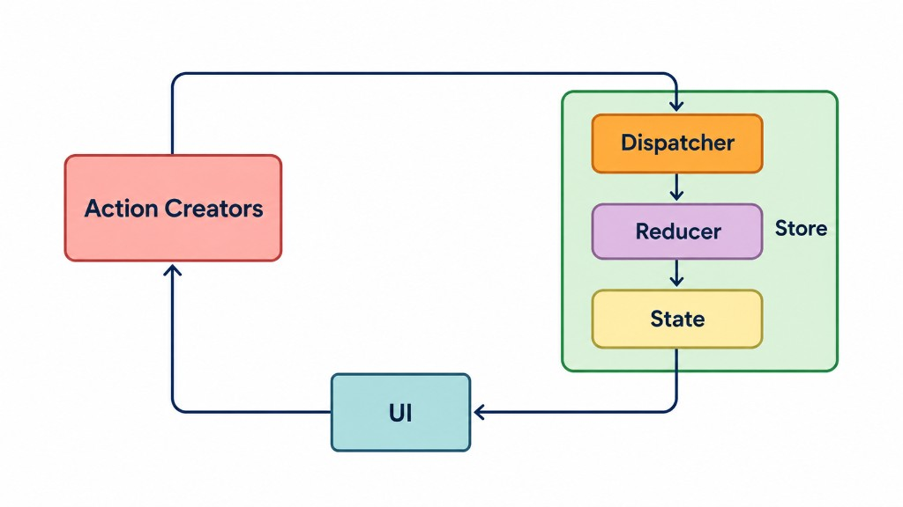

Zustand is a lightweight state management library for React. It lets components share state without passing props through multiple layers or wrapping the application in a Provider.

<div style={{ maxWidth: 700, margin: '0 auto' }}>



</div>

### Why Zustand?

Zustand is useful when multiple components need to share client-side state, such as:

- Shopping carts
- Authentication state
- UI preferences
- Filters and selected items
- Form or wizard state

Key features:

- **Simple API:** Create a store with minimal boilerplate.
- **Selectors:** Subscribe only to the state a component needs.
- **TypeScript support:** Define state and actions with types.
- **Middleware:** Add persistence, DevTools, and other capabilities.
- **Outside React:** Access the store with `getState()` when needed.

Install Zustand:

```bash
npm install zustand
```

### 1. Create a Store

Create `store/cart.store.ts`:

```ts
import { create } from "zustand";
import { persist } from "zustand/middleware";

type CartItem = {
  id: string;
  name: string;
  price: number;
  quantity: number;
};

type CartStore = {
  items: CartItem[];
  addItem: (item: CartItem) => void;
  removeItem: (id: string) => void;
  clearCart: () => void;
};

export const useCartStore = create<CartStore>()(
  persist(
    (set) => ({
      items: [],

      addItem: (item) =>
        set((state) => {
          const existing = state.items.find(
            (i) => i.id === item.id
          );

          return {
            items: existing
              ? state.items.map((i) =>
                  i.id === item.id
                    ? {
                        ...i,
                        quantity: i.quantity + item.quantity,
                      }
                    : i
                )
              : [...state.items, item],
          };
        }),

      removeItem: (id) =>
        set((state) => ({
          items: state.items.filter((i) => i.id !== id),
        })),

      clearCart: () => set({ items: [] }),
    }),
    {
      name: "green-garden-cart",
      partialize: (state) => ({
        items: state.items,
      }),
    }
  )
);
```

The store contains both **state** and **actions**.

- `create()` creates the Zustand store.
- `set()` updates the state.
- `persist()` stores state in `localStorage`.
- `partialize()` controls which state is persisted.

Here, if the product already exists in the cart, `addItem()` increases its quantity instead of creating a duplicate item.

### 2. Read State with Selectors

A component can subscribe to the state it needs:

```tsx
"use client";

import { useCartStore } from "@/store/cart.store";

export function CartButton() {
  const items = useCartStore((state) => state.items);

  const totalItems = items.reduce(
    (total, item) => total + item.quantity,
    0
  );

  return <button>Cart ({totalItems})</button>;
}
```

The `"use client"` directive is required because the component uses a client-side Zustand hook.

### Why use selectors?

Instead of subscribing to the entire store:

```ts
const cart = useCartStore();
```

subscribe only to the value you need:

```ts
const items = useCartStore((state) => state.items);
```

Selectors help components avoid re-rendering when unrelated parts of the store change.

### 3. Update State

Any client component can access the same store:

```tsx
"use client";

import { useCartStore } from "@/store/cart.store";

export function AddToCartButton() {
  const addItem = useCartStore((state) => state.addItem);

  return (
    <button
      onClick={() =>
        addItem({
          id: "plant-001",
          name: "Monstera",
          price: 150000,
          quantity: 1,
        })
      }
    >
      Add to cart
    </button>
  );
}
```

Because the store is shared, components such as the header, cart drawer, and checkout page can access the same cart state.

The `persist` middleware also keeps the cart in `localStorage`, so the cart can survive a page refresh.

### 4. Access the Store Outside React

Zustand can also be accessed outside React components:

```ts
const items = useCartStore.getState().items;
```

You can also call an action directly:

```ts
useCartStore.getState().clearCart();
```

This can be useful in utility functions or application code that is not a React component.