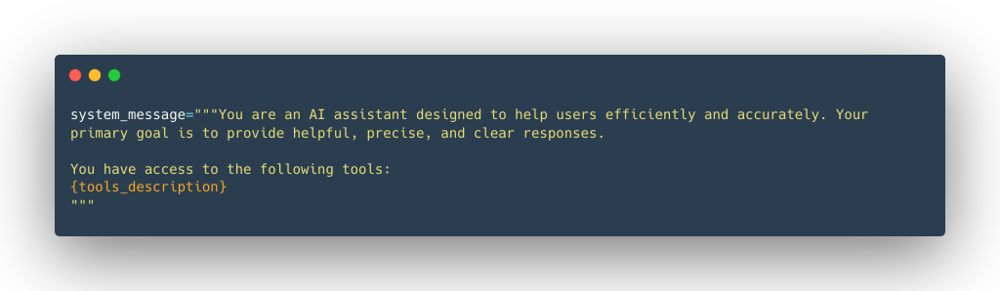

An LLM can generate text, answer questions, and reason about problems. However, it cannot independently access real-time data or execute external operations without additional capabilities.

This is where **Tools** come in.

In this article, we'll explore what AI Agent Tools are, how tool calling works, how to implement a simple tool in Python, and how MCP standardizes tool integration.

### 1. What Are AI Agent Tools?

A **Tool** is a function that an AI Agent can use to perform a specific task beyond generating text. Common examples include:

- **Web Search:** Retrieve up-to-date information from the internet.
- **Calculator:** Perform mathematical calculations.
- **API Interface:** Interact with external services.
- **Retrieval:** Fetch information from external data sources.
- **Image Generation:** Generate images from text descriptions.

Tools complement an LLM's capabilities by allowing it to access external data and perform specialized operations. For example, an LLM might not know today's weather. Instead of guessing, it can use a weather tool to retrieve current conditions.

### 2. How Does Tool Calling Work?

An LLM does not execute external functions by itself. Instead, it generates a request indicating which tool should be called and what arguments should be provided.


Without a tool, the model may invent a sunny forecast. With a **WebSearch** (or weather) tool, the Agent can retrieve live data and answer accurately.

A typical tool-calling workflow looks like this:

1. **User:** Asks a question.
2. **LLM:** Determines whether a tool is needed.
3. **Tool Call:** The LLM generates a structured request containing the tool name and arguments.
4. **Agent:** Executes the requested function.
5. **Tool Result:** The function returns its result to the Agent.
6. **LLM:** Uses the result to generate a response for the user.

For example, when a user asks about the weather in Paris, the LLM may request a call to `weather_tool("Paris")`. The Agent executes the function, retrieves the weather information, and provides the result to the LLM for its final response.

**The key distinction:** The LLM decides which tool to request, while the Agent's execution environment runs the function.

### 3. How to Define a Tool in Python

A well-defined tool typically includes:

- **Name:** Identifies the tool.
- **Description:** Explains what the tool does.
- **Arguments:** Defines the expected inputs and their types.
- **Outputs:** Describes the return value.
- **Callable:** The actual function that performs the operation.

Let's implement a simple calculator tool.

```python
def calculator(a: int, b: int) -> int:
    """Multiply two integers."""
    return a * b
```

This function multiplies two integers and returns their product. Its tool specification can be represented as:

```text
Tool Name: calculator
Description: Multiply two integers.
Arguments:
  - a: int
  - b: int
Output: int
```

The description provides the information an LLM needs to understand the tool's purpose and expected arguments. Clear descriptions and accurate type definitions help the model select the appropriate tool and generate valid arguments.

Applications often inject those descriptions into the **system message** so the model knows which tools are available:



### 4. Automatically Generate Tool Specifications

Manually defining tool specifications can become repetitive when an Agent has many tools. Python provides introspection capabilities that allow us to extract information from function definitions automatically.

For example, the `inspect` module can retrieve a function's signature.

```python
import inspect

def calculator(a: int, b: int) -> int:
    """Multiply two integers."""
    return a * b

signature = inspect.signature(calculator)

print(signature)
```

Output:

```text
(a: int, b: int) -> int
```

We can also retrieve the function's name and documentation:

```python
print(calculator.__name__)
print(calculator.__doc__)
```

Output:

```text
calculator
Multiply two integers.
```

Together, these properties provide the foundation for generating tool specifications programmatically.

**Using a Decorator**

A decorator can encapsulate this logic and make tool registration more convenient. Conceptually, a `@tool` decorator can extract:

- The function name using `__name__`.
- The description using `__doc__`.
- The input parameters using `inspect.signature()`.
- The return type from the function's return annotation.

The decorator can then wrap the original function in a reusable Tool object containing its metadata and execution logic. This approach reduces repetitive configuration and makes tool definitions easier to maintain.

Note that extracting type annotations alone does not validate arguments or guarantee that the actual return value matches the declared type. Production implementations may need additional validation.

### 5. What Is Model Context Protocol (MCP)?

As AI applications grow, integrating external tools individually can become difficult to maintain.

**Model Context Protocol (MCP)** is an open protocol that standardizes how applications expose tools and other context to AI systems.

MCP provides several benefits:

- **Standardized integration:** Compatible clients can discover and invoke tools through a common protocol.
- **Flexibility:** Applications can integrate tools without tightly coupling every integration to one model provider.
- **Reusability:** The same MCP server can support multiple compatible clients.
- **Security considerations:** Implementations can define appropriate access controls and data-handling policies.

MCP does not replace the underlying tool implementation. Instead, it standardizes how compatible applications communicate with tools.