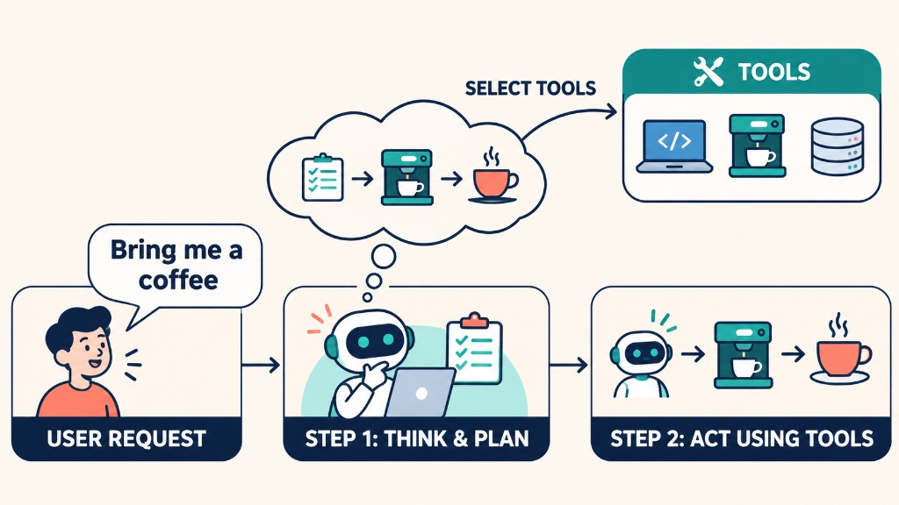

Large Language Models (LLMs) have transformed how we build AI applications. They can understand natural language, generate text, write code, and solve problems. However, generating a response is different from taking action.

An **AI Agent** extends the capabilities of an AI model by allowing it to make decisions, use tools, and interact with its environment to achieve a specific goal.

In this article, we will explore how AI Agents work, their core components, and their practical applications.

### 1. What Is an AI Agent?

Imagine asking a personal assistant to make you a cup of coffee. The assistant needs to understand your request, plan the necessary steps, use a coffee machine, and bring you the finished coffee.

<div style={{ maxWidth: 700, margin: '0 auto' }}>



</div>

An AI Agent follows a similar process:

1. **Understand:** Interpret the user's request.
2. **Reason and Plan:** Determine the steps required to achieve the goal.
3. **Act:** Select and execute appropriate tools.
4. **Observe:** Evaluate the results and decide whether further actions are needed.

Formally, an AI Agent is a system that uses an AI model to interact with its environment and achieve a user-defined objective.

The key characteristic is its ability to use decisions to control actions rather than simply generate text.

### 2. The Core Components of an AI Agent

An AI Agent can be understood through two main components.

**The Brain: AI Model**

The model is responsible for understanding instructions, reasoning about problems, and deciding which actions to take. Common choices include GPT, Gemini, and Qwen.

Most Agents use Large Language Models (LLMs), although Vision-Language Models (VLMs) can also be used when visual understanding is required.

**The Body: Tools and Capabilities**

Tools enable an Agent to interact with external systems. Examples include:

- `web_search()` — Search for information online.
- `query_database()` — Retrieve information from a database.
- `send_email()` — Send emails.
- `run_python()` — Execute Python code.

The model decides which tool to use, while the application executes the corresponding function. An Agent's capabilities depend on the tools and permissions provided by its developers.

### 3. Understanding the Spectrum of Agency

Not every AI application has the same level of agency. We can distinguish several levels:

| Level | Type | Description |
| --- | --- | --- |
| 0 | Simple LLM | Generates responses without controlling program execution. |
| 1 | Router | Selects between predefined workflows. |
| 2 | Tool Caller | Chooses and executes functions. |
| 3 | Multi-step Agent | Controls an iterative process until a task is completed. |
| 4 | Multi-Agent System | Coordinates multiple Agents or agentic workflows. |

The higher levels generally allow the AI to influence more of the execution process.

For example, a simple chatbot might answer a question directly, while a multi-step Agent could search for information, analyze the results, and perform additional actions based on what it discovers.

### 4. How Do AI Agents Take Action?

An LLM primarily generates outputs. To interact with external systems, an application provides tools that the model can invoke.

Consider an Agent that needs to send an email:

```python
def send_email(recipient, message):
    """Send an email to a recipient."""
    # Integrate with an email service.
    ...
```

When a user asks the Agent to postpone a meeting, the model can determine that sending an email is necessary and request the appropriate function call.

The application then validates the arguments and executes the function. This process allows the Agent to turn a natural-language instruction into a real action.

It is also important to distinguish between **tools and actions**. A tool is a capability available to the Agent, while an action is an operation performed toward a goal. A single action may require multiple tools.

### 5. Real-World Applications

AI Agents can support a wide range of applications.

- **Personal Assistants:** Manage schedules, send messages, and set reminders.

- **Customer Support:** Answer questions, retrieve customer information, and create support tickets.

- **Research Agents:** Search multiple sources, analyze information, and generate summaries.

- **Gaming:** Power non-player characters (NPCs) that respond dynamically to player interactions.

- **Business Automation:** Retrieve data, generate reports, and execute predefined workflows.

In each case, the Agent's effectiveness depends on the model, available tools, and quality of the implementation.