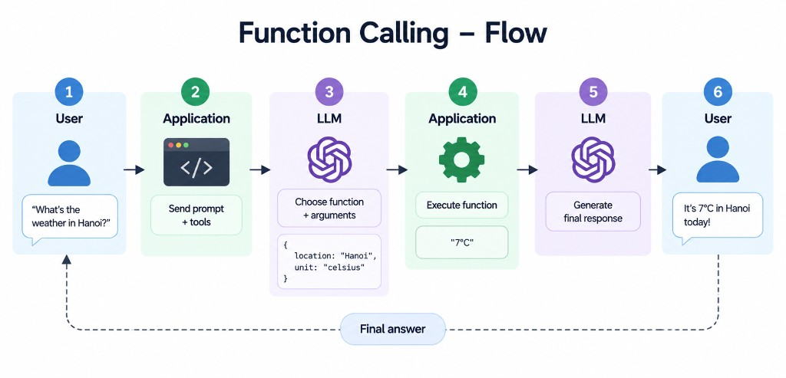

Large Language Models (LLMs) can understand natural language and generate responses, but they cannot directly interact with external systems unless they are connected to tools. **Function calling** enables an LLM to select appropriate functions and generate the arguments needed to execute them.

### 1. What Is Function Calling?

Function calling, also known as tool use, allows an LLM to translate a user's natural-language request into a structured function call.

For example, an LLM can help an application:

- Retrieve weather information from an external API.
- Look up stock prices.
- Perform calculations using Python functions.
- Read and summarize web pages.
- Create images using an image-generation pipeline.
- Extract structured information from documents, such as resumes.

The LLM decides which tool is appropriate and provides its arguments. Your application executes the function and handles the result.

### 2. How Function Calling Works

A typical function-calling workflow consists of five steps:

1. **Define tools:** Provide the LLM with function names, descriptions, and parameter schemas.
2. **Analyze the request:** The LLM determines whether a tool is needed.
3. **Generate a tool call:** The LLM returns the selected function name and arguments.
4. **Execute the function:** Your application validates the arguments and runs the corresponding function.
5. **Generate the final response:** Send the tool result back to the LLM so it can formulate a natural-language answer.



The important distinction is that the LLM usually does not execute your Python function itself. It generates a structured request, and your application performs the actual execution.

### 3. Defining a Function Schema

Tools are commonly described using a JSON Schema that specifies the function name, purpose, and parameters.

For example, a weather tool can be defined as follows:

```python
weather_tool = {
    "type": "function",
    "function": {
        "name": "get_current_weather",
        "description": "Get the current weather in a city.",
        "parameters": {
            "type": "object",
            "properties": {
                "location": {
                    "type": "string",
                    "description": "The city name."
                },
                "unit": {
                    "type": "string",
                    "enum": ["celsius", "fahrenheit"],
                    "description": "The temperature unit."
                }
            },
            "required": ["location", "unit"],
            "additionalProperties": False
        },
        "strict": True
    }
}
```

A good schema helps the model understand when to use the tool and which arguments it must provide. Enums can restrict arguments to predefined values, while required fields help enforce the expected structure.

The `strict` option is supported by compatible OpenAI APIs and models; exact schema requirements vary by provider.

### 4. Implementing Function Calling with Python

Consider the request:

```text
What is the weather like in Hanoi today?
```

The model might generate a tool call with these arguments:

```json
{
    "location": "Hanoi",
    "unit": "celsius"
}
```

Your application can parse the arguments and execute the function.

```python
import json

def get_current_weather(
    location: str,
    unit: str
) -> str:
    # Replace this example with a real weather API.
    return f"Current weather in {location}: 7°C"

arguments = json.loads(
    '{"location": "Hanoi", "unit": "celsius"}'
)

result = get_current_weather(**arguments)

print(result)
```

Output:

```text
Current weather in Hanoi: 7°C
```

This example demonstrates local function execution. The returned temperature is hardcoded, so it is not actual live weather data.

In a real application, you would send the tool definition to the LLM, inspect its response, execute the requested function, and return the result to the model.

### 5. Completing the Tool-Calling Loop

The full workflow requires another LLM request after executing the function.

With OpenAI's Chat Completions API, the process looks like this:

```python
import json
from openai import OpenAI

client = OpenAI()

messages = [
    {
        "role": "user",
        "content": "What is the weather in Hanoi?"
    }
]

response = client.chat.completions.create(
    model="YOUR_SUPPORTED_MODEL",
    messages=messages,
    tools=[weather_tool]
)

assistant_message = response.choices[0].message

if assistant_message.tool_calls:
    messages.append(assistant_message)

    for tool_call in assistant_message.tool_calls:
        if tool_call.function.name == "get_current_weather":
            arguments = json.loads(
                tool_call.function.arguments
            )

            result = get_current_weather(**arguments)

            messages.append({
                "role": "tool",
                "tool_call_id": tool_call.id,
                "content": result
            })

    final_response = client.chat.completions.create(
        model="YOUR_SUPPORTED_MODEL",
        messages=messages
    )

    print(final_response.choices[0].message.content)
else:
    print(assistant_message.content)
```

Replace `YOUR_SUPPORTED_MODEL` with a model available to your account that supports tool calling.

This example illustrates the basic loop. Production implementations should also validate arguments, handle exceptions, check API responses, and support multiple tool calls when returned.

### 6. Generating Tool Schemas Automatically

Manually maintaining function schemas can become difficult when a function has many parameters or changes frequently.

Python's `inspect` module and Pydantic can help generate schema information from function definitions and type annotations.

For example:

```python
from pydantic import TypeAdapter

def calculate_total(
    price: float,
    quantity: int
) -> float:
    """Calculate the total price."""
    return price * quantity

schema = TypeAdapter(calculate_total).json_schema()

print(schema)
```

This generates a JSON Schema describing the function's input structure. However, generating the schema alone does not create a complete tool definition. You still need to provide the function name, description, and any provider-specific formatting required by the API.

For complex applications, dedicated schema-generation utilities can reduce duplicated definitions and help keep tool contracts consistent.

### 7. Best Practices

When implementing function calling, consider the following practices:

- **Use descriptive names:** Prefer `get_current_weather` over vague names such as `get_data`.
- **Write clear descriptions:** Explain what each function does and when it should be used.
- **Define strict parameter schemas:** Specify types, required fields, enums, and additional-property restrictions where supported.
- **Validate every argument:** Model-generated arguments should not automatically be trusted.
- **Handle errors:** Return useful error information when an API or function fails.
- **Limit available tools:** Provide relevant tools instead of exposing every function to every request.
- **Protect sensitive operations:** Require appropriate authorization and confirmation for actions such as purchases, deletions, or financial transactions.
- **Keep execution under application control:** The model proposes tool calls; your code determines whether and how to execute them.

### 8. Function Calling and MCP

Function calling and the Model Context Protocol (MCP) solve related but different problems.

**Function calling** is a model interaction pattern in which the LLM selects a tool and generates structured arguments.

**MCP** is an open protocol for connecting AI applications to external tools and data sources through a standardized interface.

An MCP server can expose tools to compatible clients, while those clients can use an LLM's tool-calling capabilities to decide when to invoke them. MCP does not replace the underlying model's reasoning or eliminate the need for authorization and validation.

### Conclusion

Function calling extends LLM applications beyond text generation by connecting language models to APIs, Python functions, databases, and other external systems.

The essential workflow is straightforward: define tools, let the model select a function and generate arguments, execute the function in your application, and return the result to the model.

This pattern is a fundamental building block for AI assistants and agents that need to retrieve information, perform calculations, or take actions in external systems.
