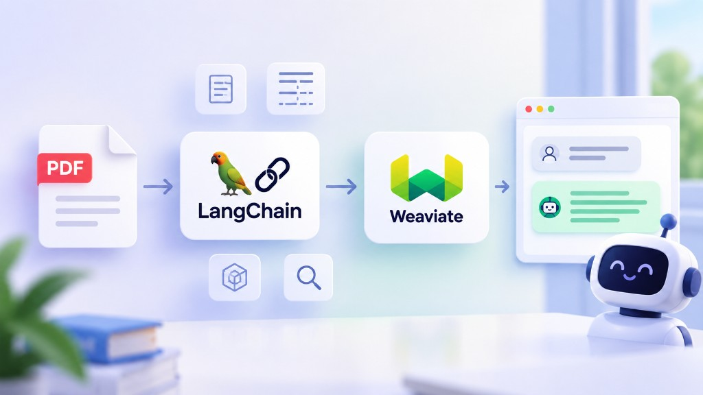

LangChain is an open-source framework for building applications powered by Large Language Models (LLMs). It provides reusable components for connecting language models with documents, vector databases, external APIs, and other data sources.

In this article, we will explore LangChain's architecture, advantages, limitations, and role in building a PDF question-answering application using Retrieval-Augmented Generation (RAG).



### 1. What Is LangChain?

LangChain simplifies the development of LLM applications by providing standardized interfaces and reusable components.

Instead of implementing every integration from scratch, developers can use existing components for tasks such as loading documents, splitting text, generating embeddings, retrieving relevant information, and interacting with language models.

For example, a basic PDF-based RAG application can use LangChain to connect a document loader, a text splitter, a vector store, and an LLM.

### 2. Advantages of LangChain

**Standardized Interfaces**

LangChain provides common interfaces for many supported model providers and integrations.

For example, different chat models can be initialized using provider-specific classes:

```python
from langchain_anthropic import ChatAnthropic
from langchain_openai import ChatOpenAI

model = ChatOpenAI(model="YOUR_OPENAI_MODEL")

# Alternatively, use an Anthropic model:
# model = ChatAnthropic(model="YOUR_ANTHROPIC_MODEL")
```

Switching providers may require only a few code changes when the application uses compatible interfaces. However, model capabilities, configuration options, and response behavior can still differ.

**Reusable Components**

LangChain provides components for common LLM application tasks.

Loading PDF documents:

```python
from langchain_community.document_loaders import PyMuPDFLoader

loader = PyMuPDFLoader("docs/rag-paper.pdf")
documents = loader.load()
```

Splitting text into chunks:

```python
from langchain_text_splitters import RecursiveCharacterTextSplitter

text_splitter = RecursiveCharacterTextSplitter(
    chunk_size=1000,
    chunk_overlap=200
)

chunks = text_splitter.split_documents(documents)
```

Storing embeddings in ChromaDB:

```python
from langchain_chroma import Chroma
from langchain_openai import OpenAIEmbeddings

vectorstore = Chroma.from_documents(
    documents=chunks,
    embedding=OpenAIEmbeddings(
        model="YOUR_SUPPORTED_EMBEDDING_MODEL"
    )
)
```

These components reduce the amount of integration code developers need to write. They can also be combined with retrieval and generation components to implement a RAG pipeline.

### 3. Limitations of LangChain

Despite its benefits, LangChain introduces trade-offs that developers should consider.

**Learning Curve**

LangChain has many abstractions, interfaces, and integrations. Beginners may find it difficult to understand how the components interact, especially when debugging a complex chain.

For small applications, using a provider's SDK directly may be simpler.

**Dependency and Version Management**

LangChain's ecosystem includes separate packages for core interfaces and third-party integrations. APIs and package requirements can change between releases.

To reduce compatibility problems:

- Pin dependency versions.
- Read migration guides before upgrading.
- Follow the documentation for the installed package version.
- Test integrations after making changes.

**Alternative Frameworks**

Several alternatives address overlapping use cases:

- **LangGraph:** Supports stateful, multi-step agent workflows.
- **LlamaIndex:** Focuses on connecting LLMs with data and retrieval pipelines.
- **Pydantic AI:** Provides typed tools and structured workflows for AI applications.
- **OpenAI Agents SDK:** Provides components for building agent-based applications using OpenAI's ecosystem.
- **Direct provider SDKs:** Offer a lightweight approach when only a few API calls or tools are required.

No single framework is best for every project. The choice depends on application complexity, integration requirements, and the amount of abstraction the team wants.

### 4. Understanding LangChain's Package Structure

LangChain uses multiple packages to separate core abstractions from provider integrations.

| Package | Purpose |
| --- | --- |
| `langchain` | High-level components for building LLM applications. |
| `langchain-core` | Core interfaces, messages, prompts, and runnable abstractions. |
| `langchain-openai` | Integration with OpenAI models and embeddings. |
| `langchain-anthropic` | Integration with Anthropic models. |
| `langchain-community` | Community-maintained integrations and utilities. |
| `langchain-text-splitters` | Utilities for splitting documents into chunks. |
| `langchain-chroma` | Integration with Chroma vector stores. |

Install only the packages required by your application.

For example:

```bash
pip install langchain-community langchain-text-splitters langchain-chroma langchain-openai pymupdf
```

Keeping integrations in separate packages helps manage dependencies and makes it easier to install only the components you need.

### 5. Building a PDF Chatbot with LangChain

A common application of LangChain is a chatbot that answers questions using uploaded PDF documents.

The architecture follows a standard RAG workflow.

**Step 1: Document Loading**

Use a document loader such as `PyMuPDFLoader` to extract text and metadata from a PDF.

**Step 2: Text Chunking**

Split the extracted text into smaller chunks using `RecursiveCharacterTextSplitter`. Chunking makes document retrieval more manageable and helps fit relevant content into the model's context window.

**Step 3: Embedding and Storage**

Convert the chunks into vector embeddings and store them in ChromaDB.

**Step 4: Retrieval**

When the user asks a question, retrieve the chunks most relevant to the query.

**Step 5: Answer Generation**

Pass the retrieved chunks and the user's question to the LLM. The model uses this context to generate an answer.

A Gradio interface can provide a chat UI for users to upload documents and ask questions.

```text
PDF Document
     |
     v
Document Loader
     |
     v
Text Splitter
     |
     v
Embedding Model
     |
     v
Chroma Vector Store
     |
     v
Retrieve Relevant Chunks
     |
     v
LLM + User Question
     |
     v
Generated Answer
```

For production applications, consider adding source citations, document-level access controls, retrieval evaluation, error handling, and mechanisms for updating or deleting indexed documents.

### Conclusion

LangChain provides reusable components that simplify the development of LLM applications, particularly those involving document processing, embeddings, vector databases, and RAG.

Its main benefits are standardized interfaces and a broad integration ecosystem. Its main trade-offs are additional abstractions, dependency management, and the need to understand its component architecture.

For a PDF question-answering application, start with three core components: document loaders, text splitters, and vector stores. Once the basic retrieval pipeline is working, you can add an LLM and a chat interface to build a complete RAG application.
