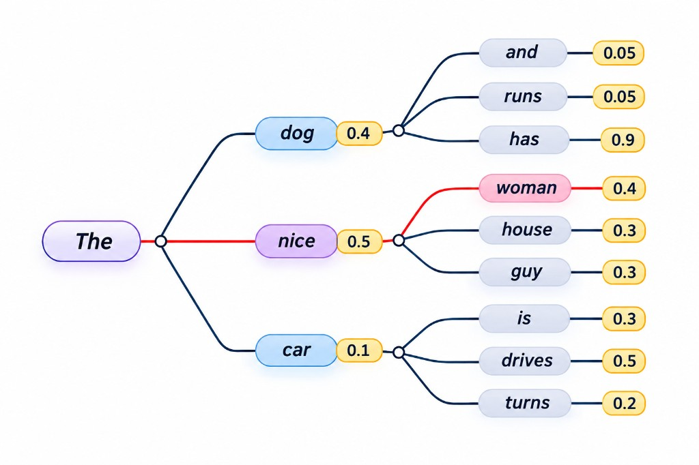
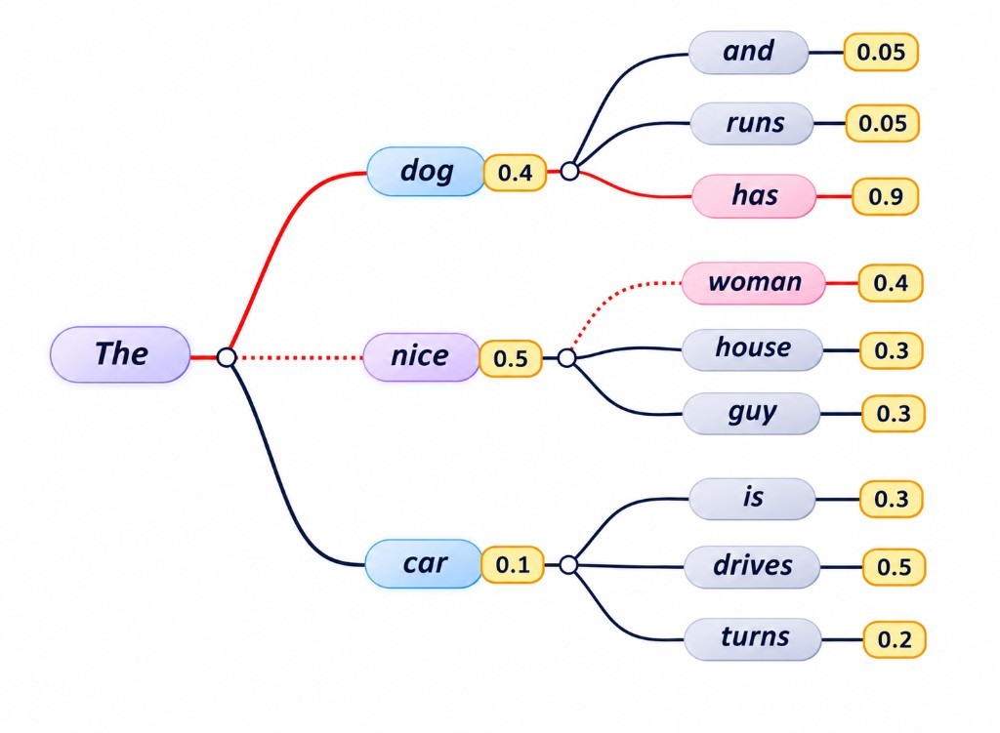
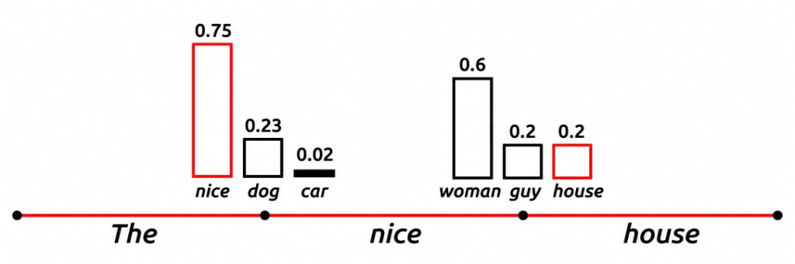
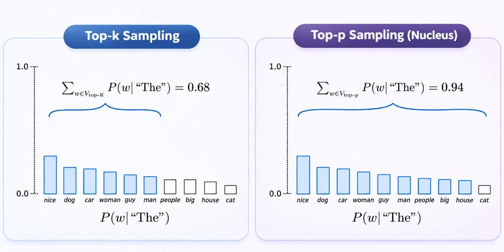

**Large Language Models (LLMs)** generate text one token at a time. Given an input sequence, the model predicts the probability of possible next tokens and selects one to continue the text.

But how does it decide which token to choose? The answer lies in **decoding strategies**, which determine how a model selects the next token from its predicted probability distribution.

Let's explore the most common approaches.

### 1. Greedy Decoding

**Greedy decoding** always selects the token with the highest probability at each step.

<div style={{ maxWidth: 700, margin: '0 auto' }}>



</div>

Starting from `The`, the model compares candidates such as `dog` (0.4), `nice` (0.5), and `car` (0.1), then selects `nice`. From there it again picks the highest-probability continuation, `woman` (0.4), producing `The nice woman`. The process repeats for every subsequent token.

```python
output = model.generate(
    **model_inputs,
    max_new_tokens=40
)
```

For standard generation configurations, this uses greedy decoding when sampling and beam search are disabled.

**Limitations:**

- Makes locally optimal decisions without exploring alternative sequences.
- Can produce repetitive or predictable text.

A token with the highest immediate probability does not necessarily lead to the best overall sequence.

### 2. Beam Search

**Beam search** addresses this limitation by maintaining multiple candidate sequences instead of selecting only one at each step.

<div style={{ maxWidth: 700, margin: '0 auto' }}>



</div>

In the diagram, the dotted path follows greedy decoding: `The nice woman` (0.5 × 0.4 = 0.20). The solid path keeps a lower first-step probability with `dog` (0.4), then continues with `has` (0.9), producing `The dog has` (0.4 × 0.9 = 0.36). By comparing sequences rather than only the next token, beam search can prefer the stronger overall candidate.

The `num_beams` parameter determines the number of candidate sequences retained during the search.

```python
output = model.generate(
    **model_inputs,
    max_new_tokens=40,
    num_beams=5,
    early_stopping=True
)
```

With `num_beams=5`, the algorithm explores up to five candidate sequences at each decoding step.

**Limitations:**

- Requires more computation than greedy decoding.
- Can still produce repetitive or less diverse text.

Beam search is often useful for tasks such as translation, but it is not necessarily the best choice for open-ended conversations or creative writing.

### 3. Sampling Decoding

Instead of always selecting the most probable token, **sampling** randomly selects a token according to the predicted probability distribution. A token with a lower probability can still be selected, allowing more diverse outputs.



In the example above, after `The` the model may select `nice` (0.75). At the next step, `woman` has the highest probability (0.6), but sampling can still choose `house` (0.2), producing `The nice house`.

```python
output = model.generate(
    **model_inputs,
    max_new_tokens=40,
    do_sample=True
)
```

Because selection involves randomness, repeated generations can produce different results from the same prompt. Sampling is particularly useful for creative writing, conversational applications, and tasks where multiple answers may be acceptable. However, unrestricted sampling can also produce incoherent or irrelevant text.

**Temperature** adjusts the probability distribution before sampling. Mathematically, the adjusted probabilities are:

Here, `T` represents the temperature.

- **Low temperature:** Concentrates probability on the most likely tokens, producing more predictable outputs.
- **High temperature:** Distributes probability more broadly, allowing less likely tokens to be selected more often.

Example:

```python
output = model.generate(
    **model_inputs,
    max_new_tokens=40,
    do_sample=True,
    temperature=0.7
)
```

A temperature of `0.7` is a common starting point, although the best value depends on the model and task. Note that temperature does not guarantee accuracy. Lower temperature can make outputs more predictable, but it cannot ensure that they are factually correct.

### 4. Top-k and Top-p Sampling

Temperature changes the probability distribution, while **top-k** and **top-p** restrict which tokens are eligible for sampling.



**Top-k Sampling:** Keeps only the `k` most probable tokens and samples from that subset. In the diagram, with `top_k=6`, only the six highest-probability tokens after `The` are kept, covering a cumulative probability of 0.68. Lower-ranked tokens such as `people`, `big`, `house`, and `cat` are excluded.

**Top-p Sampling:** Also called **nucleus sampling**, selects the smallest set of likely tokens whose cumulative probability reaches or exceeds a specified threshold `p`. In the example above, the nucleus expands until the cumulative probability reaches 0.94, so more tokens remain eligible than under a fixed `k`, while the least likely token (`cat`) is still filtered out.

Example:

```python
output = model.generate(
    **model_inputs,
    max_new_tokens=40,
    do_sample=True,
    temperature=0.7,
    top_k=50,
    top_p=0.9
)
```

In practice, top-k and top-p are alternative filtering strategies, although some implementations allow both to be applied together.

### Conclusion

LLMs generate text by repeatedly predicting the next token and selecting one according to a decoding strategy. Greedy decoding favors the most probable token, beam search explores multiple candidate sequences, and sampling introduces controlled randomness. Temperature, top-k, and top-p provide additional ways to influence the generation process.

Understanding these mechanisms helps developers tune LLMs for different applications, balancing predictability, diversity, and computational cost.

**The model predicts the possibilities; the decoding strategy determines how the next token is selected.**
