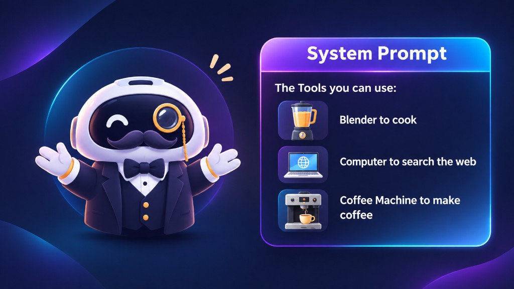

When interacting with an LLM through ChatGPT or an AI Agent, we see a conversation consisting of user messages and assistant responses. However, behind the scenes, the model processes a structured sequence of tokens rather than the chat interface we see.

Understanding how **messages**, **special tokens**, and **chat templates** work is essential for building reliable LLM applications and AI Agents.

### 1. Messages: How Conversations Are Represented

A conversation is typically represented as a list of **messages**. Each message contains a **role** and some **content**.

```python
messages = [
    {"role": "system", "content": "You are a helpful AI assistant."},
    {"role": "user", "content": "What is RAG?"},
    {"role": "assistant", "content": "RAG stands for Retrieval-Augmented Generation."}
]
```

Common roles include:

- `system`: Defines instructions and behavioral guidelines.
- `user`: Contains input from the user.
- `assistant`: Contains responses generated by the model.
- `tool`: Contains results returned by an external tool in frameworks that support tool messages.

In a typical **stateless** inference request, the application includes the relevant conversation history in the model's input. The model does not automatically remember previous interactions in the human sense.

### 2. Special Tokens: Structuring the Conversation

LLMs use **special tokens** to identify message boundaries and other structural information. For example, a model using the ChatML-style format might represent a conversation like this:

```text
<|im_start|>user
What is RAG?<|im_end|>
<|im_start|>assistant
RAG stands for Retrieval-Augmented Generation.<|im_end|>
```

Some important tokens include:

| Token | Purpose |
| --- | --- |
| `<\|im_start\|>` | Marks the beginning of a message. |
| `<\|im_end\|>` | Marks the end of a message. |
| `<\|begin_of_text\|>` | Marks the beginning of text in formats that use it. |
| `<\|start_header_id\|>` | Marks the beginning of a header in Llama 3's format. |
| `<\|end_header_id\|>` | Marks the end of a header in Llama 3's format. |
| `<\|eot_id\|>` | Marks the end of a message in Llama 3's format. |

Different models use different special tokens and formatting conventions.

It is also important to distinguish between ending a message and ending an assistant turn. For example, some formats use separate tokens to indicate that an assistant turn is complete or that control is being handed to a tool.

**Key takeaway:** Special tokens provide structural information that helps the model interpret the conversation.

### 3. System Messages: Guiding Model Behavior

A **system message** defines instructions that guide the model's behavior.

<div style={{ maxWidth: 700, margin: '0 auto' }}>



</div>

For example:

```python
messages = [
    {
        "role": "system",
        "content": "You are a helpful AI assistant specializing in Python."
    },
    {
        "role": "user",
        "content": "Explain Python decorators."
    }
]
```

In AI Agent applications, system messages can also describe available tools, define when they should be used, and specify the expected output format — for example, a blender to cook, a computer to search the web, or a coffee machine to make coffee. However, describing a tool in a system message does not execute it. The application must implement the actual tool execution mechanism.

### 4. Chat Templates: Converting Messages into Model Inputs

A **chat template** defines how structured messages are converted into the format expected by a particular model. For example, the same conversation could be formatted differently depending on whether the model uses ChatML, Llama-style formatting, or another template.

This is important because models are trained using particular input formats. Providing messages in an incompatible format can lead to unexpected behavior.

In Hugging Face Transformers, chat templates are commonly defined using Jinja2. A simplified example looks like this:

```jinja2

<|im_start|>{{ message['role'] }}
{{ message['content'] }}<|im_end|>

```

This template iterates over the messages and formats each one using its role and content. Actual templates may contain additional logic for system messages, tool calls, multimodal inputs, and other model-specific requirements.

### 5. Applying a Chat Template with Transformers

Hugging Face Transformers provides `apply_chat_template()` to format conversations according to a tokenizer's configured template.

First, define the messages:

```python
messages = [
    {
        "role": "system",
        "content": "You are a helpful AI assistant."
    },
    {
        "role": "user",
        "content": "What is an AI Agent?"
    }
]
```

Load the tokenizer:

```python
from transformers import AutoTokenizer

tokenizer = AutoTokenizer.from_pretrained(
    "HuggingFaceTB/SmolLM2-1.7B-Instruct"
)
```

Apply the chat template:

```python
prompt = tokenizer.apply_chat_template(
    messages,
    tokenize=False,
    add_generation_prompt=True
)

print(prompt)
```

The parameters mean:

- `messages`: The conversation history.
- `tokenize=False`: Returns the formatted prompt as a string.
- `add_generation_prompt=True`: Adds the model-specific prefix needed to begin generating an assistant response.

The resulting prompt can then be passed to the model, subject to the inference interface being used. Using the tokenizer's configured template is generally safer than manually constructing special-token sequences.

### 6. Base Models vs. Instruct Models

Another important concept is the difference between **base models** and **instruction-tuned models**.

**Base Models:** A base model is trained primarily to predict the next token from its context. For example:

```text
Input: The capital of France is
```

The model may predict:

```text
Paris.
```

A base model is not necessarily optimized to follow instructions or participate in structured conversations.

**Instruct Models:** An instruct model undergoes additional training to improve its ability to follow instructions and respond to user requests. For example:

```text
User: Explain RAG in simple terms.
```

The model is trained to produce an appropriate explanatory response.

The distinction matters because formatting a prompt correctly does not automatically give a base model the behavior of an instruction-tuned model.

**Chat templates define input structure; instruction tuning changes the model's learned behavior.**

### 7. How Chat Templates Relate to AI Agents

Chat templates become especially important when an LLM interacts with external tools. Consider an agent that answers questions about the weather.

A simplified interaction might look like this:

1. The user asks about the weather in Hanoi.
2. The application provides the conversation to the LLM.
3. The LLM generates a tool call requesting weather information.
4. The application executes the weather tool.
5. The tool returns its result.
6. The application adds the result to the conversation.
7. The LLM generates a final answer.

Conceptually, the interaction could be represented as:

```text
User:
What is the weather in Hanoi?

Assistant:
Request weather information for Hanoi.

Tool:
Temperature: 28°C
Condition: Cloudy

Assistant:
It is 28°C and cloudy in Hanoi.
```

This is a conceptual illustration rather than a literal model-specific prompt format. In a real implementation, tool calls may use structured arguments and special tokens or other conventions defined by the model and framework.

The important distinction is that the LLM requests an action, while the application executes the tool and returns its result. Chat templates help represent this interaction in a format the model understands.