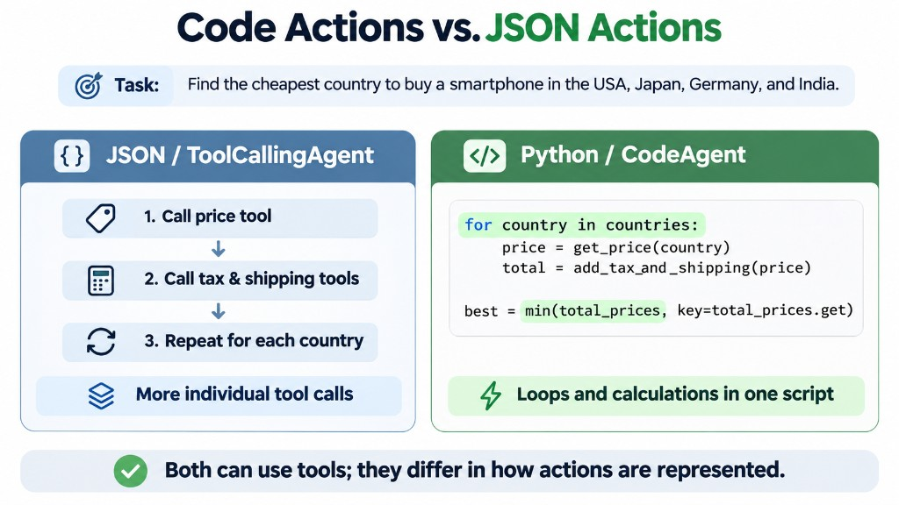

**smolagents** is a lightweight Python framework developed by Hugging Face for building AI agents. An AI agent can use a Large Language Model (LLM) to understand a task, choose actions, use tools, and work toward a result.

For example, a plant shop chatbot could use an AI agent to look up plant prices and recommend suitable plants to customers.

### 1. Why use smolagents?

smolagents offers several advantages:

- **Simple:** Easy to learn and get started.
- **Flexible:** Supports different LLM providers.
- **Code-first:** Agents can write Python code to perform actions.
- **Tool integration:** Agents can use Python functions and external tools.

It is a good choice when you want to experiment with AI agents without building a complex system from scratch.

### 2. CodeAgent vs. ToolCallingAgent

smolagents supports two main agent types.

<div style={{ maxWidth: 700, margin: '0 auto' }}>



</div>

**CodeAgent** generates Python code to perform actions. For example, it can write a loop to retrieve prices from multiple countries and find the cheapest option.

**ToolCallingAgent** generates structured tool calls, typically using JSON, to request specific actions. For example, it can call a `get_plant_price` tool to retrieve a plant's price.

The main difference is how they represent actions: CodeAgent uses Python code, while ToolCallingAgent uses structured tool calls. Both can use tools — they differ in how actions are expressed.

### 3. Connecting an LLM

smolagents supports different ways to connect language models, including:

- `TransformersModel` for models running through Transformers.
- `InferenceClientModel` for Hugging Face inference services.
- `LiteLLMModel` for connecting to multiple model providers.
- `OpenAIServerModel` for services with an OpenAI-compatible API.

This flexibility allows developers to choose a model based on their requirements and budget.

### 4. Creating Tools

Tools allow an agent to interact with external systems or perform specific tasks. In smolagents, you can define a tool using the `@tool` decorator. For example:

```python
from smolagents import tool

@tool
def get_plant_price(plant_name: str) -> str:
    """Get the price of a plant."""
    return f"The price of {plant_name} is 500000 VND."
```

An agent can use this function when it needs to retrieve a plant's price. In a real application, the function could call an API or query a database instead.

### 5. When Should You Use smolagents?

smolagents is useful when you want to:

- Build a simple AI agent quickly.
- Experiment with tool calling and code execution.
- Connect an LLM to Python functions.
- Automate tasks involving multiple steps.

However, applications with complex workflows may require additional architecture and orchestration.

### Conclusion

smolagents provides a simple way to build AI agents in Python. Its main strengths are simplicity, flexible model integration, and support for code-based actions.

Understanding **CodeAgent**, **ToolCallingAgent**, and **tools** provides a solid foundation for building more practical AI applications.
