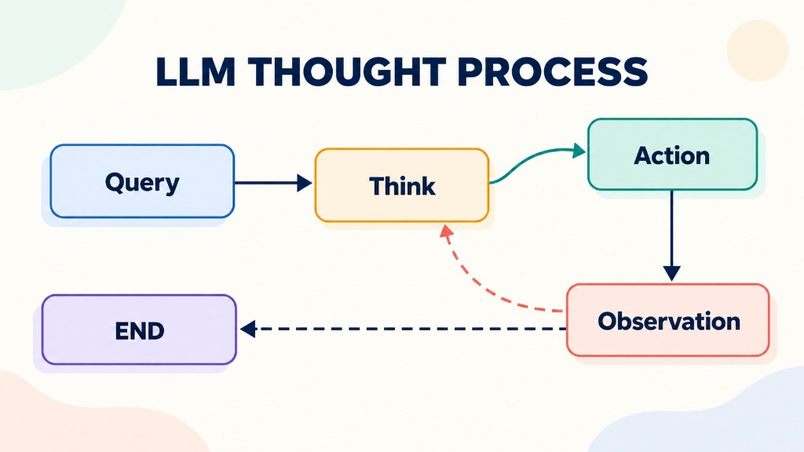
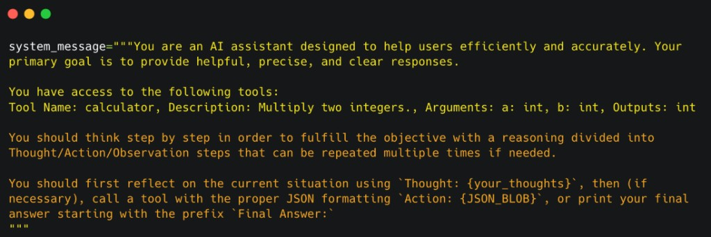

AI Agents are systems powered by Large Language Models (LLMs) that can reason about tasks, decide what to do next, use external tools, and adapt their behavior based on the results.

Unlike a traditional LLM that generates an answer based primarily on its available context, an AI Agent can interact with external systems to retrieve information, execute operations, and solve multi-step problems.

### 1. Understanding the Thought–Action–Observation Cycle

<div style={{ maxWidth: 700, margin: '0 auto' }}>



</div>

The agent follows a continuous workflow:

1. Analyze the user's request.
2. Determine the next action.
3. Execute the action using an available tool.
4. Observe the result.
5. Use the result to decide what to do next.
6. Return a final answer when the task is complete.

For example, consider a user asking: "What is the current weather in New York?"

The agent can use the following workflow:

| Stage | Description |
| --- | --- |
| Thought | Determine that current weather data is required. |
| Action | Call the `get_weather` tool with `New York` as the location. |
| Observation | Receive weather data from the API. |
| Updated Thought | Determine whether the returned data is sufficient. |
| Final Answer | Present the weather information to the user. |

If the API returns an error or incomplete data, the agent may attempt another action instead of immediately generating a final answer.

The key idea is that **each observation provides feedback that can influence the agent's next decision**.

### 2. Thought: Internal Reasoning and Planning

**Thought** represents the reasoning and planning performed by the LLM to determine the next step. Depending on the task, the agent may need to:

- Break a complex problem into smaller tasks.
- Analyze information from previous actions.
- Choose an appropriate tool.
- Evaluate alternative approaches.
- Identify missing information.
- Determine whether the task is complete.

**Common Types of Thought**

| Type | Purpose | Example |
| --- | --- | --- |
| Planning | Break a task into steps | Fetch data → analyze → report |
| Analysis | Interpret available information | Spot a database connection error |
| Decision Making | Choose the next action | Pick a product within budget |

These are conceptual categories rather than separate mandatory stages in every agent implementation.

**Chain-of-Thought (CoT)**

**Chain-of-Thought (CoT)** is a prompting technique designed to help a model solve problems through intermediate reasoning steps. For example, consider the question: "What is 15% of 200?"

The calculation can be broken down into:

1. Calculate 10% of 200: 20.
2. Calculate 5% of 200: 10.
3. Add the results: 20 + 10 = 30.

Therefore, the answer is 30.

CoT is particularly useful for tasks involving logical reasoning, mathematical calculations, and multi-step problem-solving. However, CoT does not inherently require external tools. The model can reason about a problem without interacting with an external environment.

**Important distinction:** CoT describes a reasoning approach. It does not necessarily define how an agent executes actions or manages its workflow.

### 3. ReAct: Combining Reasoning and Acting

**ReAct** stands for **Reasoning and Acting**. It is an approach that combines reasoning with external actions, allowing an agent to alternate between deciding what to do and observing the results.

In practice, this pattern is often encoded in the **system message**, which lists available tools and instructs the model to respond with `Thought`, `Action`, or `Final Answer`:



A simplified ReAct workflow looks like this:

```text
User Request
     |
     v
   Thought
     |
     v
    Action
     |
     v
 Observation
     |
     v
Updated Thought
     |
     +------> Another Action
     |
     +------> Final Answer
```

**CoT vs. ReAct**

| Feature | Chain-of-Thought | ReAct |
| --- | --- | --- |
| Step-by-step reasoning | Yes | Yes |
| External tool usage | Not inherently required | Integrated into the workflow |
| Environmental feedback | Not a defining feature | Used to inform subsequent reasoning |
| Typical applications | Mathematics and logical reasoning | Web search, API integration, and multi-step tasks |

CoT and ReAct are not mutually exclusive. ReAct can incorporate intermediate reasoning while interacting with external tools.

### 4. Action: Enabling the Agent to Interact with Its Environment

An **Action** is an operation performed by an agent to interact with an external system or environment. Actions can include:

- Searching the web.
- Retrieving database records.
- Calling APIs.
- Running calculations.
- Executing code.

The LLM typically determines which action to request and supplies the necessary arguments. A framework or runtime then interprets and executes that request.

**Types of Agent Implementations**

Three common approaches to representing actions are JSON-based actions, code-based actions, and function calling.

| Approach | How It Works | Main Characteristic |
| --- | --- | --- |
| JSON Agent | Produces structured data describing an action | Predictable and easy to validate |
| Code Agent | Generates code for execution in a runtime | Flexible and expressive |
| Function-calling Agent | Uses a model/API-supported mechanism to request function execution | Structured tool selection and arguments |

These categories describe different implementation approaches and are not necessarily mutually exclusive.

**JSON-Based Actions**

A JSON-based agent can express a tool request using a structured object. For example:

```json
{
  "tool": "calculate_total",
  "arguments": {
    "price": 100000,
    "quantity": 3
  }
}
```

The framework parses the request and invokes the corresponding tool. If the calculation tool multiplies the price by the quantity, the result is 300,000.

JSON is useful when actions can be represented as a predefined set of operations with clearly defined parameters.

**Code-Based Actions**

A **Code Agent** generates executable code to perform a task. For example:

```python
def calculate_total(price, quantity):
    return price * quantity

total = calculate_total(100_000, 3)
print(total)
```

Code-based actions offer several advantages:

- **Expressiveness:** Support loops, conditions, and complex logic.
- **Modularity:** Allow reusable functions and components.
- **Flexibility:** Combine multiple operations in a single program.
- **Data Processing:** Work with external libraries and APIs.

However, executing AI-generated code introduces security risks. A production system should use appropriate isolation, restricted permissions, resource limits, and execution policies. Sensitive credentials should not be exposed to generated code.

**Function Calling**

**Function calling** allows a model to request execution of a predefined function through a structured interface. For example, an application might define a function named `get_plant_price` with a required `plant_name` argument.

The model can request:

```json
{
  "plant_name": "Monstera"
}
```

The exact request format depends on the model API and tool schema. The application then executes the function and returns its result to the model.

Importantly, **a function call is a request to execute an operation, not the execution itself**. The application or agent runtime is responsible for carrying out the operation and handling its result.

### 5. The Stop-and-Parse Approach

The **stop-and-parse** approach describes a way to turn model-generated output into an executable action. A simplified implementation consists of three stages.

**Stage 1: Generate**

The model produces a structured action request.

```json
{
  "tool": "get_weather",
  "arguments": {
    "location": "New York"
  }
}
```

**Stage 2: Stop**

The model finishes generating the action request, and control returns to the agent framework. The stopping mechanism depends on the implementation. It might involve a structured output boundary, a tool-call signal, or a completed model response.

**Stage 3: Parse and Execute**

The framework:

1. Validates the action request.
2. Identifies the requested tool.
3. Extracts and validates its arguments.
4. Executes the tool if the request is permitted.
5. Captures the result.

The result is then made available to the model as an observation. This approach helps separate the model's decision-making from the application's execution logic.

In production systems, parsing alone is not sufficient. Tool permissions, argument validation, authorization, error handling, and execution limits are also essential.

### 6. Observation: Integrating Feedback

**Observation** represents the information an agent receives after an action has been executed. It tells the agent what happened and provides evidence that can guide its next decision.

Observations may contain:

- API responses.
- Database query results.
- Error messages.
- Execution logs.

**Types of Observations**

| Type | Example |
| --- | --- |
| System Feedback | An API returns HTTP 500. |
| Data Changes | A database confirms that an order was created. |
| Response Analysis | A query returns a list of products. |

**How Observations Are Processed**

After an action, the framework typically performs the following operations:

1. Parse and validate the action request.
2. Execute the requested tool.
3. Capture the result or error.
4. Add the observation to the agent's execution context.
5. Allow the model to determine the next step.

For example, a database tool might return:

```json
{
  "name": "Monstera",
  "price": 350000,
  "currency": "VND"
}
```

The agent can use this observation to answer the user. If the tool instead returns an error, the agent may retry the operation, use an alternative tool, request additional information, or explain that it could not complete the task.

The appropriate response depends on the error, the task requirements, and the agent's execution policies.