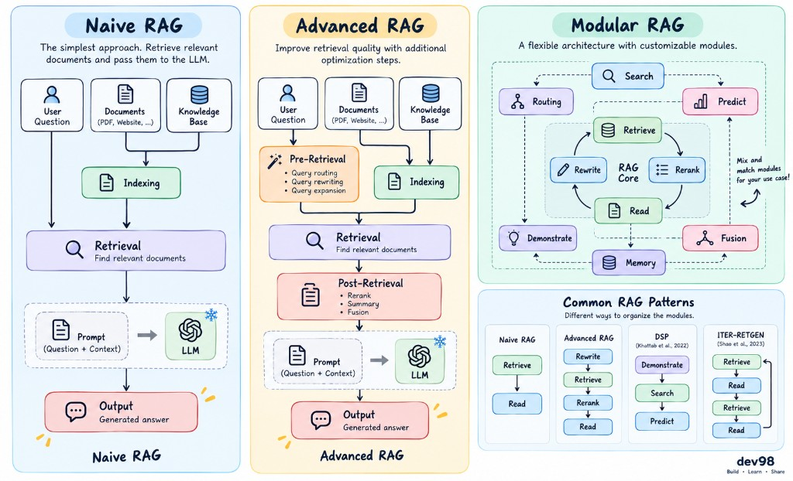

Large Language Models (LLMs) can generate fluent responses, but they may lack up-to-date information or access to private data stored in external systems. Retrieval-Augmented Generation (RAG) addresses this limitation by retrieving relevant information and providing it to the model as context.



### 1. What Is RAG?

**Retrieval-Augmented Generation (RAG)** is a technique that combines information retrieval with text generation.

Instead of relying only on knowledge learned during training, an LLM can use relevant information retrieved from external sources, such as documents, databases, or APIs.

For example, imagine building a chatbot that answers questions about your company's products. The LLM may not know the latest product prices or inventory.

Rather than putting the entire product catalog into every prompt, the application retrieves relevant product information and passes it to the LLM.

The model then uses that information to generate a response.

### 2. How RAG Works

A basic RAG pipeline consists of two main phases: indexing and retrieval.

**Phase 1: Indexing**

Prepare the knowledge base before users ask questions.

1. Collect documents from relevant data sources.
2. Split documents into smaller chunks when appropriate.
3. Convert the chunks into embeddings using an embedding model.
4. Store the embeddings, original content, and metadata in a searchable index, such as a vector database.

This process runs initially and is repeated when the knowledge base changes.

**Chunking and embeddings, clarified**

- **Chunking** splits long documents into smaller passages. Each chunk should be large enough to keep useful context, but small enough to stay focused and fit comfortably in prompts. Overlap between chunks can reduce the risk of cutting an important sentence in half.
- **Embeddings** turn each chunk into a numerical vector. At query time, the same embedding model converts the user's question into a vector so the system can find chunks with similar meaning.
- Keep the embedding model consistent between indexing and querying. Mixing models usually produces incompatible vector spaces.

**Phase 2: Retrieval and Generation**

When a user submits a question:

1. **Embed the query:** Convert the question into a vector using a compatible embedding model.
2. **Retrieve relevant content:** Search the index for documents or chunks related to the query.
3. **Build the context:** Combine the retrieved information with the user's question.
4. **Generate the answer:** Send the context to the LLM and ask it to produce a response grounded in the retrieved information.

The overall workflow looks like this:

```text
Knowledge Base
      |
      v
Document Chunking
      |
      v
Embedding Model
      |
      v
Vector Database
      |
      |                 User Question
      |                        |
      |                        v
      |                 Query Embedding
      |                        |
      |                        v
      +----------------> Similarity Search
                               |
                               v
                      Retrieved Documents
                               |
                               v
                         LLM + Context
                               |
                               v
                         Final Answer
```

A vector database is common in RAG systems, but it is not mandatory. Retrieval can also use keyword search, SQL queries, external APIs, or a combination of methods.

### 3. Why Is RAG Important?

RAG helps address several practical limitations of LLMs.

**Access to updated information**

A model's training data may not include recent information. RAG allows an application to retrieve current information from an external knowledge source without retraining the model every time the data changes.

**Better-grounded answers**

Providing relevant documents gives the model evidence to use when answering questions. A well-designed system can also instruct the model to acknowledge when the retrieved context does not contain enough information.

However, RAG does not eliminate hallucinations. Retrieval can return irrelevant information, and the model can still misinterpret the context.

**Source citations**

Retrieved documents can include identifiers, URLs, page numbers, or other metadata. The application can use this information to display citations that help users verify an answer.

**Lower adaptation costs**

When a knowledge base changes frequently, updating the indexed documents is often more practical than fine-tuning a model for every change.

### 4. Common RAG Applications

RAG is useful whenever an LLM needs to answer questions using an external knowledge source.

Common examples include:

- **Internal knowledge assistants:** Answer questions using company documentation.
- **Customer support chatbots:** Retrieve product details, policies, and troubleshooting guides.
- **Document analysis:** Search and summarize reports, manuals, and legal documents.
- **Product recommendation assistants:** Retrieve relevant products based on user requirements.
- **Technical assistants:** Search API documentation, code repositories, and engineering guides.

For example, a chatbot for an online plant shop could retrieve plant descriptions, growing instructions, and care guides before answering a customer's question.

Structured information such as current prices and stock levels may be better retrieved directly from the application's database or API rather than relying exclusively on semantic search.

### 5. A Practical RAG Example

Consider a small plant-care knowledge base and a customer question: "How much light does a Monstera need?"

```python
from sentence_transformers import SentenceTransformer
from sentence_transformers.util import cos_sim

model = SentenceTransformer("all-MiniLM-L12-v2")

# Indexed chunks (after splitting source documents)
chunks = [
    "Monstera plants prefer bright, indirect light.",
    "Water a Monstera when the top layer of soil dries out.",
    "Snake plants tolerate low-light conditions.",
]

chunk_vectors = model.encode(chunks)

question = "How much light does a Monstera need?"
query_vector = model.encode(question)

scores = cos_sim(query_vector, chunk_vectors)[0]
top_index = scores.argmax().item()
context = chunks[top_index]

prompt = f"""Answer the question using only the context below.
If the context does not contain the answer, say you don't know.

Context:
{context}

Question:
{question}
"""

# Send `prompt` to your LLM API to generate the final answer.
print(context)
print(prompt)
```

This example covers the retrieval half of RAG in memory. In production, replace the in-memory list with a vector database, retrieve several top chunks, attach source metadata for citations, and validate that the user is allowed to see those documents.

### 6. Types of RAG Systems

RAG architectures can be described at different levels of complexity.

**Naive RAG**

The simplest approach retrieves relevant chunks and sends them to the LLM.

Its main limitations are irrelevant results, duplicate content, and poor retrieval quality.

**Advanced RAG**

This approach improves retrieval and generation with techniques such as:

- Query rewriting to improve search results.
- Metadata filtering to narrow the search scope.
- Hybrid search combining keyword and vector retrieval.
- Reranking to prioritize the most relevant results.
- Better chunking and context construction.

**Modular RAG**

A modular architecture separates retrieval, preprocessing, ranking, generation, and other stages into configurable components.

This makes it easier to customize the pipeline for different applications.

These categories are architectural descriptions rather than strict, universally standardized classifications.

### 7. RAG vs. Function Calling

RAG and function calling both extend what an LLM application can do, but they serve different purposes.

| Aspect | RAG | Function Calling |
| --- | --- | --- |
| Primary purpose | Retrieve relevant knowledge | Select and invoke tools |
| Typical use | Search documents and answer questions | Call APIs or execute operations |
| Model output | An answer grounded in retrieved context | A structured tool call with arguments |
| Execution | Application retrieves relevant information | Application executes the selected function |

For example, a shopping assistant might use function calling to decide whether to search products, check an order, or retrieve a customer's cart.

When answering a question about a return policy, it could use RAG to retrieve the relevant policy document.

A single application can combine both approaches: function calling determines which operation to perform, while RAG supplies relevant knowledge for the response.

### 8. RAG vs. Long Context Windows

Modern LLMs can process large amounts of text in a single request. This raises an important question: if a model can accept thousands or even millions of tokens, why use RAG?

Long-context prompting can work well when the relevant material is manageable and the task benefits from seeing the entire document.

RAG remains useful when:

- The knowledge base is too large to include in every request.
- Only a small subset of documents is relevant to each question.
- Token usage and response latency need to be controlled.
- Access permissions must be applied during retrieval.
- The application needs to search and cite specific source documents.

Long context also does not guarantee that a model will use every piece of supplied information correctly. Conversely, RAG quality depends on finding the right content in the first place.

The best approach depends on the size of the knowledge base, the task, latency requirements, costs, and evaluation results. Some applications combine long-context processing with retrieval.

### 9. Beyond Basic RAG

Production RAG systems often include additional components to improve retrieval quality, reliability, and security.

- **Hybrid search:** Combines semantic similarity with keyword matching.
- **Reranking:** Reorders retrieved candidates using a more targeted relevance model.
- **Evaluation:** Measures retrieval relevance, answer correctness, and groundedness.
- **Access control:** Ensures retrieved content is authorized for the current user.
- **Agentic RAG:** Allows an agent to decide when to search, which tools to use, and whether additional retrieval is necessary.

The Model Context Protocol (MCP) can also help connect AI applications to external tools and data sources, although it is a tool-integration protocol rather than a RAG technique itself.

### Conclusion

Retrieval-Augmented Generation enables LLM applications to use external knowledge during response generation. A typical implementation prepares and indexes documents, retrieves relevant information for each query, and supplies that information to the model as context.

RAG is especially useful for applications involving private documentation, frequently updated data, customer support, and knowledge-intensive tasks.

Understanding the basic pipeline is the first step toward building more advanced systems with hybrid search, reranking, citations, evaluation, and agent-based retrieval.
