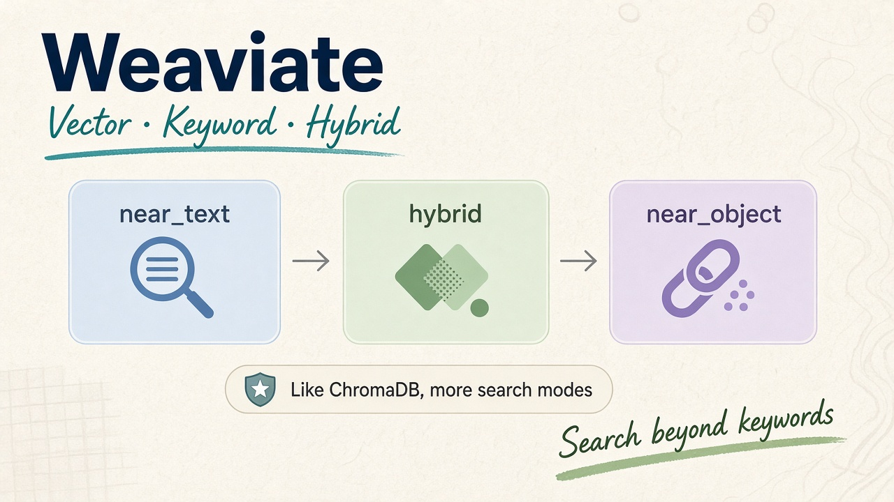

Weaviate is an open-source vector database that stores objects and their vector representations. It supports semantic search, keyword-based retrieval, hybrid search, and similarity search, making it useful for applications such as movie recommendations, product discovery, and RAG systems.

In this article, we will explore three ways to query a Weaviate collection: `near_text`, `hybrid`, and `near_object`.



### 1. Semantic Search with `near_text`

Semantic search retrieves objects based on the meaning of a query rather than requiring exact keyword matches.

For example, suppose we want to find movies related to:

```text
funny children story
```

We can query Weaviate using `near_text`:

```python
movie_collection = vector_db_client.collections.get(
    "MovieCollection"
)

response = movie_collection.query.near_text(
    query="funny children story",
    limit=5
)

for result in response.objects:
    movie = result.properties

    print(
        f"Title: {movie['title']}, "
        f"Genres: {movie['genres']}"
    )
```

Weaviate converts the query into a vector using the configured vectorizer and searches for similar movie representations.

The results may include movies associated with comedy, family, or children's stories, even when their titles do not contain the exact query terms.

**Use `near_text` when:** Users search using natural language and you want to retrieve content based on semantic relevance.

### 2. Hybrid Search with `hybrid`

Semantic search is useful, but sometimes exact keyword matches matter too.

For example, searching for `thriller` should ideally return movies explicitly associated with that genre, while semantic search can also identify related descriptions.

Weaviate's hybrid search combines two retrieval methods:

- **BM25:** Keyword-based search that evaluates textual relevance.
- **Vector search:** Semantic retrieval based on embedding similarity.

Example:

```python
response = movie_collection.query.hybrid(
    query="thriller",
    alpha=0.5,
    limit=5
)

for result in response.objects:
    movie = result.properties

    print(
        f"Title: {movie['title']}, "
        f"Genres: {movie['genres']}"
    )
```

The `alpha` parameter controls the balance between vector search and keyword search:

| Alpha | Search behavior |
| --- | --- |
| `0` | Keyword search |
| `0.5` | Combines keyword and vector search |
| `1` | Vector search |

Hybrid search is particularly useful when an application needs both semantic relevance and exact terminology.

### 3. Similarity Search with `near_object`

Sometimes, you already have an object and want to find similar objects.

For example, a movie recommendation application might suggest films similar to *Hard Kill*.

Instead of providing a text query, you can use the UUID of the existing object:

```python
object_id = "ff59a0d2-134a-4559-bfcf-8ebaa89416d7"

response = movie_collection.query.near_object(
    near_object=object_id,
    limit=5
)

for result in response.objects:
    movie = result.properties

    print(
        f"Title: {movie['title']}, "
        f"Genres: {movie['genres']}"
    )
```

Weaviate uses the reference object's vector to find nearby vectors in the collection.

This allows the application to discover similar movies without manually constructing a search query.

The results depend on how the movie embeddings were generated. Similar vectors do not necessarily guarantee identical genres or themes.

**Use `near_object` when:** Building recommendation features such as similar products, related articles, or movie suggestions.

### 4. Understanding UUIDs

Each object in Weaviate has a UUID that identifies it within the collection.

If you do not specify a UUID when inserting an object, Weaviate can generate one automatically.

You can also provide a UUID yourself:

```python
collection.data.insert(
    properties={
        "title": "Example Movie",
        "genres": ["Action", "Thriller"]
    },
    uuid="12345678-e64f-5d94-90db-c8cfa3fc1234"
)
```

Using a stable identifier can make it easier to reference existing objects across application workflows.

However, the UUID must be valid, and inserting an object with an existing identifier may fail or require an explicit update operation, depending on the API used.

### 5. Choosing the Right Search Method

| Method | Best use case |
| --- | --- |
| `near_text` | Natural-language semantic search |
| `hybrid` | Combining keyword matching with semantic relevance |
| `near_object` | Finding objects similar to an existing object |

These methods can also be combined with metadata filters, result limits, and other retrieval options to build more precise search experiences.

For example, a movie application could use hybrid search to find thriller movies, filter the results by release year, and retrieve similar movies for recommendations.

### Conclusion

Weaviate provides several ways to retrieve relevant information from a vector database.

- `near_text` searches by semantic meaning.
- `hybrid` combines keyword and vector search.
- `near_object` finds objects similar to an existing object.

Understanding these query methods is an important step toward building practical vector-search applications. They can power movie recommendations, product discovery, semantic document search, and retrieval pipelines for RAG-based AI assistants.

In the next step, you can combine Weaviate with a user interface such as Gradio to build an interactive movie-search application.
