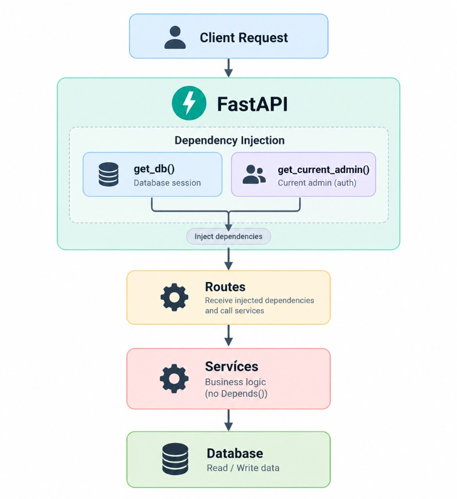

**Dependency Injection (DI)** allows a function to declare what it needs while another component provides it. This reduces coupling and makes applications easier to test and maintain.

<div style={{ maxWidth: 700, margin: '0 auto' }}>



</div>

### 1. The Basic Idea

Without dependency injection, a route might create and manage its own database session:

```python
async def get_plants():
    db = AsyncSessionLocal()
    try:
        # Query plants
        ...
    finally:
        await db.close()
```

The route is responsible for both creating and cleaning up the database session.

With FastAPI's dependency injection, the route declares its requirements using `Depends()`:

```python
from fastapi import Depends
from sqlalchemy.ext.asyncio import AsyncSession

async def get_plants(
    db: AsyncSession = Depends(get_db),
):
    # Query plants using db
    ...
```

The route only declares what it needs. FastAPI resolves the dependency and manages its lifecycle according to how `get_db` is implemented.

This separates **what a function needs** from **how that dependency is created**.

### 2. Dependencies Can Depend on Other Dependencies

Dependencies can be composed to share common logic across routes.

For example, an authentication dependency may require a database session to retrieve the current administrator:

```python
async def get_current_admin(
    request: Request,
    db: AsyncSession = Depends(get_db),
) -> Admin:
    # Extract and validate the token
    # Retrieve the administrator from the database
    ...
```

Here, `get_current_admin` depends on `get_db`.

A protected route can then use the authentication dependency:

```python
@app.get("/api/admin/plants")
async def get_admin_plants(
    admin: Admin = Depends(get_current_admin),
    db: AsyncSession = Depends(get_db),
):
    ...
```

FastAPI resolves the dependency chain automatically. By default, dependencies using the same callable and cache settings are reused within a request, so `get_db` can provide the same session to both dependencies.

### 3. Why Dependency Injection Is Useful

**Loose Coupling**

Routes don't need to know how database sessions are created, and authentication logic can be reused across multiple endpoints.

**Reusability**

Common dependencies, such as database sessions, authenticated users, and pagination parameters, can be shared across routes.

**Testability**

Dependencies can be replaced during testing without modifying the route implementation.

For example, a test can override the database dependency:

```python
app.dependency_overrides[get_db] = get_test_db
```

After testing, clear the override when appropriate:

```python
app.dependency_overrides.clear()
```

This allows routes to use a test database instead of the production database. In a larger test suite, remove only the overrides your test added to avoid interfering with other tests.

### Key Takeaways

- `Depends()` declares a dependency that FastAPI resolves.
- Dependencies can depend on other dependencies.
- DI separates dependency creation from business logic.
- `app.dependency_overrides` makes it easier to test routes with alternative implementations.

**The key idea:** A function declares what it needs, while dependency injection determines how those requirements are provided.
