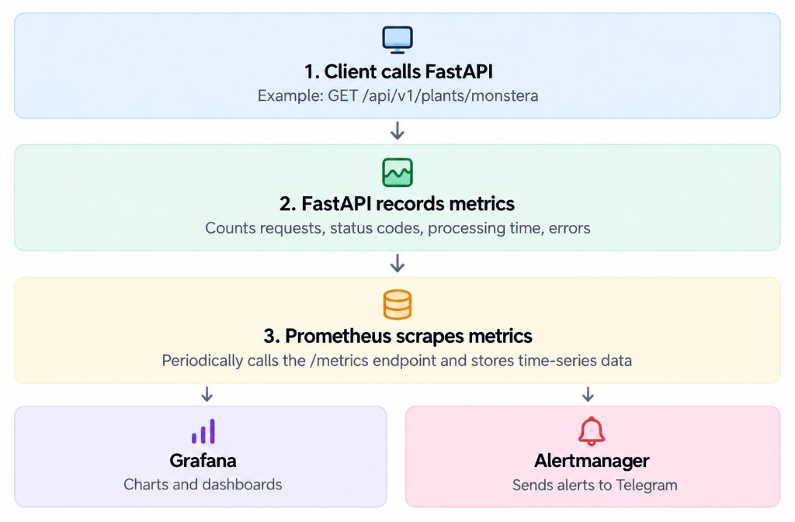

Monitoring helps you understand how your application behaves in production. For a FastAPI application running on a single VPS, Prometheus, Grafana, Alertmanager, and exporters provide a practical way to track performance, detect failures, and receive alerts.

<div style={{ maxWidth: 700, margin: '0 auto' }}>



</div>

### 1. How the Monitoring Stack Works

The monitoring workflow consists of five main steps:

1. **Client calls FastAPI:** For example, the frontend requests `GET /api/v1/plants/monstera`.
2. **FastAPI records metrics:** Middleware tracks request counts, status codes, response times, and application exceptions.
3. **Prometheus collects metrics:** Prometheus periodically scrapes `/metrics` and other configured exporters, storing the results as time series.
4. **Grafana visualizes metrics:** Grafana queries Prometheus using PromQL to display request rates, error rates, latency, CPU, memory, and database statistics.
5. **Alertmanager sends notifications:** When an alert rule fires, Prometheus sends the alert to Alertmanager, which groups and routes notifications to Telegram.

```text
Client → FastAPI → /metrics
                       ↓
                   Prometheus
                       ↓
                    Grafana
                       ↓
                 Alertmanager
                       ↓
                    Telegram
```

### 2. Project Structure

Keep monitoring configuration separate from application code:

```text
project/
├── app/
│   └── main.py
├── monitoring/
│   ├── prometheus/
│   │   ├── prometheus.yml
│   │   └── alerts.yml
│   └── alertmanager/
│       └── alertmanager.yml
├── docker-compose.yml
└── docker-compose.monitoring.yml
```

This separation makes monitoring easier to configure, maintain, and deploy independently of application changes.

### 3. Instrument FastAPI

Install the Prometheus Python client:

```bash
pip install prometheus-client
```

Expose a `/metrics` endpoint for Prometheus to scrape:

```python
from fastapi import FastAPI, Response
from prometheus_client import (
    CONTENT_TYPE_LATEST,
    generate_latest,
)

app = FastAPI()


@app.get("/metrics", include_in_schema=False)
def metrics():
    return Response(
        content=generate_latest(),
        headers={"Content-Type": CONTENT_TYPE_LATEST},
    )
```

This exposes metrics registered with the Prometheus client. To monitor application behavior, add instrumentation that records HTTP request counts, status codes, response durations, and other relevant measurements.

In production, restrict access to `/metrics`, ideally through an internal Docker network and appropriate authentication. Ensure the endpoint is excluded from public application documentation and does not expose sensitive information.

### 4. Configure Prometheus

Create `monitoring/prometheus/prometheus.yml`:

```yaml
global:
  scrape_interval: 15s

scrape_configs:
  - job_name: "fastapi"
    metrics_path: /metrics
    static_configs:
      - targets: ["api:8000"]

  - job_name: "prometheus"
    static_configs:
      - targets: ["prometheus:9090"]
```

The target `api:8000` refers to the FastAPI service name and internal port on the shared Docker network.

Prometheus scrapes each target every 15 seconds and stores the collected metrics as time series.

If the metrics endpoint requires a bearer token, configure `bearer_token_file` and mount the corresponding secret into the Prometheus container. The application must independently validate that token.

### 5. Run Prometheus and Grafana with Docker Compose

Add the monitoring services to `docker-compose.monitoring.yml`:

```yaml
services:
  prometheus:
    image: prom/prometheus:v3.1.0
    ports:
      - "127.0.0.1:9090:9090"
    volumes:
      - ./monitoring/prometheus:/etc/prometheus:ro
      - prometheus_data:/prometheus
    command:
      - --config.file=/etc/prometheus/prometheus.yml
      - --storage.tsdb.path=/prometheus
    networks:
      - monitoring

  grafana:
    image: grafana/grafana:11.4.0
    ports:
      - "127.0.0.1:3001:3000"
    volumes:
      - grafana_data:/var/lib/grafana
    networks:
      - monitoring

networks:
  monitoring:

volumes:
  prometheus_data:
  grafana_data:
```

These pinned versions illustrate a reproducible setup; select maintained versions appropriate for your deployment.

Make sure the FastAPI service also joins the `monitoring` network. When layering Compose files, verify that the network is shared correctly and avoid duplicating existing services or configuration.

Start the stack:

```bash
docker compose \
  -f docker-compose.yml \
  -f docker-compose.monitoring.yml \
  up -d
```

Check the running containers:

```bash
docker compose ps
```

### 6. Verify Prometheus

Open the Prometheus Targets page:

`http://localhost:9090/targets`

A target marked `UP` means Prometheus successfully scraped its metrics endpoint.

You can also run this PromQL query:

```promql
up
```

A value of `1` indicates a successful scrape; `0` indicates a scrape failure.

### 7. Connect Grafana to Prometheus

Open Grafana at `http://localhost:3001`.

Add a Prometheus data source with the URL:

```text
http://prometheus:9090
```

Use the internal service name when Grafana and Prometheus share a Docker network. Using `http://localhost:9090` from inside the Grafana container would point to the Grafana container itself.

After saving the data source, create dashboards for:

- Request rate and traffic volume.
- HTTP error rate.
- Response latency, including p95 latency.
- CPU and memory utilization.
- Database connection pool usage.
- Application availability.

These panels require the corresponding application metrics or infrastructure exporters to be configured and scraped.

### 8. Configure Telegram Alerts

Alerting requires Prometheus alert rules and an Alertmanager receiver.

Create `monitoring/prometheus/alerts.yml`:

```yaml
groups:
  - name: api-alerts
    rules:
      - alert: FastAPIDown
        expr: up{job="fastapi"} == 0
        for: 1m
        labels:
          severity: critical
        annotations:
          summary: "FastAPI is unavailable"
```

Add the rule file to the Prometheus configuration:

```yaml
rule_files:
  - /etc/prometheus/alerts.yml
```

Then configure Prometheus to send alerts to Alertmanager and configure an Alertmanager Telegram receiver with a bot token and chat ID.

Keep the Telegram bot token in a secret file or secure secret-management system. Never commit it to Git.

When the `FastAPIDown` condition remains true for one minute, Prometheus fires the alert. Alertmanager then routes the notification according to its configuration.

For meaningful production monitoring, add rules for sustained high error rates, elevated latency, and resource exhaustion rather than relying only on availability alerts.

### 9. Access Monitoring Securely

Avoid exposing Prometheus, Grafana, and Alertmanager directly to the public Internet without appropriate authentication and access controls.

Binding service ports to `127.0.0.1` allows access through an SSH tunnel:

```bash
ssh -N \
  -L 3001:127.0.0.1:3001 \
  -L 9090:127.0.0.1:9090 \
  -L 9093:127.0.0.1:9093 \
  user@your-vps
```

Replace `user@your-vps` with your SSH username and VPS address.

You can then access Grafana, Prometheus, and Alertmanager through their local ports. Ensure Alertmanager is configured and its port is published locally if you want to access its interface.

For a single VPS, also consider monitoring disk usage, container restarts, database health, and backup status. Prometheus itself needs retention limits and persistent storage sized for your workload.

### Key Takeaways

- **Prometheus** collects and stores metrics.
- **Grafana** visualizes metrics through dashboards.
- **Alertmanager** groups and routes alerts.
- **Exporters** expose infrastructure metrics, such as host and container resource usage.
- **Telegram** provides notifications when configured alert rules fire.
- **Docker Compose and SSH tunnels** make it practical to run and securely access a monitoring stack on a single VPS.

A useful monitoring setup should do more than display charts: it should help you detect failures early, understand performance bottlenecks, and respond to production incidents before they significantly affect users.
