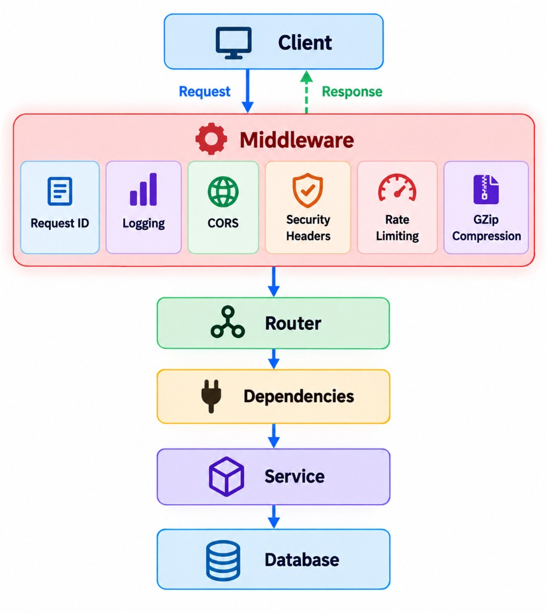

Middleware is a layer between the client and your FastAPI application. It processes incoming requests before they reach the endpoint and can modify outgoing responses before they are returned to the client.

Common use cases include request logging, request IDs, timing, security headers, CORS, and compression.

<div style={{ maxWidth: 700, margin: '0 auto' }}>



</div>

### 1. How Middleware Works

A simple HTTP middleware can measure request processing time:

```python
import time

from fastapi import FastAPI, Request

app = FastAPI()


@app.middleware("http")
async def timing_middleware(request: Request, call_next):
    start = time.perf_counter()

    response = await call_next(request)

    process_time = time.perf_counter() - start
    response.headers["X-Process-Time"] = f"{process_time:.4f}"

    return response
```

The request flows through three steps:

1. **Before `call_next()`:** Process the incoming request.
2. **At `call_next()`:** Pass the request to the next layer and await the response.
3. **After `call_next()`:** Inspect or modify the response before returning it.

### 2. Common Middleware Use Cases

**Request Logging**

Log information such as the HTTP method, URL path, status code, processing time, and request ID.

Example log output:

```text
GET /api/plants → 200 → 42ms
POST /api/orders → 201 → 85ms
```

This helps developers investigate errors and identify slow requests.

**Request ID**

A request ID uniquely identifies a request, making it easier to trace activity across application logs and services.

```python
import uuid

from fastapi import Request


@app.middleware("http")
async def request_id_middleware(request: Request, call_next):
    request_id = request.headers.get("X-Request-ID") or str(uuid.uuid4())
    request.state.request_id = request_id

    response = await call_next(request)

    response.headers["X-Request-ID"] = request_id
    return response
```

The middleware reuses the incoming `X-Request-ID` when provided; otherwise, it generates a new one. It then attaches the ID to `request.state` and returns it in the response.

In production, validate incoming request IDs and consider generating your own trusted internal identifier when necessary.

**Security Headers**

Middleware can add security-related response headers, such as:

```text
X-Content-Type-Options: nosniff
X-Frame-Options: DENY
Strict-Transport-Security: max-age=31536000
```

These headers help mitigate certain browser-based attacks. Configure HTTPS-related headers according to your deployment environment.

Other common middleware responsibilities include CORS configuration, rate limiting, and GZip compression.

### 3. Using `request.state`

FastAPI's `request.state` stores data associated with the current request.

For example, an endpoint or dependency can access the request ID:

```python
from fastapi import Request


@app.get("/api/plants")
async def get_plants(request: Request):
    request_id = request.state.request_id
    return {"request_id": request_id}
```

Use `request.state` for request-scoped information such as request IDs, timing metadata, or authenticated context attached by trusted middleware.

It is not global application state. Data stored there belongs to the individual request.

### 4. HTTP Middleware vs. ASGI Middleware

FastAPI supports two common approaches to custom middleware.

**HTTP Middleware**

The `@app.middleware("http")` decorator provides a convenient interface for typical HTTP request/response processing.

```python
@app.middleware("http")
async def logging_middleware(request: Request, call_next):
    response = await call_next(request)
    return response
```

Use this approach for straightforward tasks such as timing, logging, and adding response headers.

**ASGI Middleware**

ASGI middleware wraps the application at a lower level and directly handles the ASGI `scope`, `receive`, and `send` interfaces.

```python
class SimpleASGIMiddleware:
    def __init__(self, app):
        self.app = app

    async def __call__(self, scope, receive, send):
        if scope["type"] != "http":
            await self.app(scope, receive, send)
            return

        # Inspect or modify the HTTP request/response flow.
        await self.app(scope, receive, send)


app.add_middleware(SimpleASGIMiddleware)
```

The three ASGI components are:

- `scope`: Connection and request metadata.
- `receive`: Receives ASGI messages, including request-body events.
- `send`: Sends ASGI messages, including response headers and body events.

ASGI middleware is useful when you need lower-level control over the application interface or need to support multiple ASGI connection types.

### Key Takeaways

- **HTTP middleware** is convenient for common request/response processing.
- **ASGI middleware** provides lower-level control over the application.
- **`request.state`** stores data scoped to a single request.
- Middleware is useful for cross-cutting concerns such as logging, request tracing, timing, and security headers.

Keep middleware focused on shared request-processing concerns. Business logic and resource-specific validation generally belong in dependencies, services, or endpoints.
