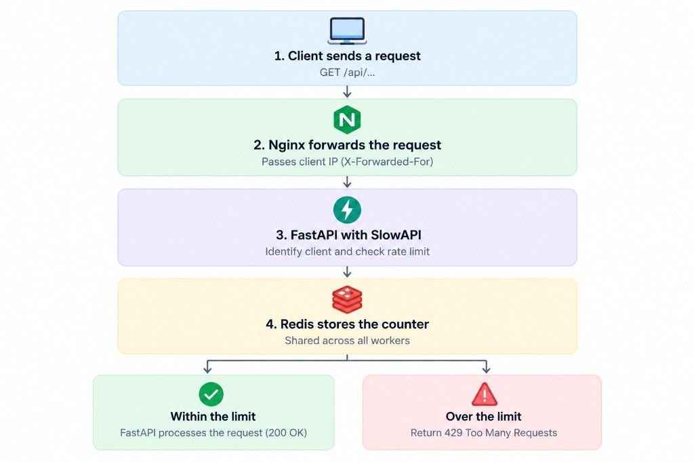

Rate limiting controls **how many requests a client can make within a specific period**. It helps protect APIs from brute-force attacks, automated abuse, and excessive resource consumption.

For example, a login endpoint might allow five attempts per minute from a single client IP address.

### 1. What Is SlowAPI?

[SlowAPI](https://github.com/laurentS/slowapi) is a rate-limiting library for FastAPI and Starlette, adapted from Flask-Limiter. It uses the `limits` library to track requests and enforce configured limits.

### 2. How Rate Limiting Works

<div style={{ maxWidth: 700, margin: '0 auto' }}>



</div>

For every request, the rate limiter performs three steps:

1. **Identify the client:** Usually by IP address or authenticated user ID.
2. **Count requests:** Update the counter for that client.
3. **Enforce the limit:** Allow the request or return HTTP `429 Too Many Requests`.

For a limit of `5/minute`, a sixth request within the applicable limiting window is rejected.

The counters can be stored in different backends:

- `memory://` stores counters in the current Python process.
- `redis://` stores counters in Redis, allowing multiple workers and servers to share rate-limit state.

Memory storage is suitable for local experimentation. Redis is generally preferable for production deployments with multiple workers.

### 3. Install Dependencies

Install SlowAPI and Redis support:

```bash
pip install slowapi redis
```

SlowAPI uses the `limits` library internally to manage rate limits.

### 4. Initialize the Rate Limiter

Create a shared limiter and register it with FastAPI.

```python
from fastapi import FastAPI
from slowapi import Limiter, _rate_limit_exceeded_handler
from slowapi.errors import RateLimitExceeded
from slowapi.util import get_remote_address

app = FastAPI()

limiter = Limiter(
    key_func=get_remote_address,
    storage_uri="memory://",
    headers_enabled=True,
)

app.state.limiter = limiter

app.add_exception_handler(
    RateLimitExceeded,
    _rate_limit_exceeded_handler,
)
```

Key configuration options:

- `key_func`: Identifies the client. Here, it uses the remote IP address.
- `storage_uri`: Defines where rate-limit counters are stored.
- `headers_enabled=True`: Enables rate-limit response headers.
- `app.state.limiter`: Makes the limiter available to the application.
- `add_exception_handler()`: Returns an appropriate response when a limit is exceeded.

For production, replace `memory://` with a Redis connection URL, such as `redis://localhost:6379/0`, and configure Redis authentication and network access appropriately.

### 5. Limit an Individual Endpoint

Use the `@limiter.limit()` decorator to protect a specific route.

```python
from fastapi import Request, Response


@app.post("/login")
@limiter.limit("5/minute")
async def login(
    request: Request,
    response: Response,
):
    return {"message": "Login endpoint"}
```

This example allows five requests per minute per client IP.

SlowAPI requires the `request: Request` parameter on decorated endpoints. Including `response: Response` allows the library to attach rate-limit headers when the endpoint returns a dictionary or Pydantic model.

Common configurations include:

| Configuration | Meaning |
| --- | --- |
| `5/minute` | 5 requests per minute |
| `100/hour` | 100 requests per hour |
| `10/minute;200/day` | Both limits apply |

For authentication endpoints, combine rate limiting with secure password hashing, generic login error messages, and appropriate account-abuse protections.

### 6. Configure a Global Rate Limit

You can also define application-wide limits that apply by default to routes handled by SlowAPI's middleware.

```python
from slowapi.middleware import SlowAPIASGIMiddleware

limiter = Limiter(
    key_func=get_remote_address,
    application_limits=["200/minute"],
    storage_uri="redis://localhost:6379/0",
    headers_enabled=True,
)

app.state.limiter = limiter

app.add_exception_handler(
    RateLimitExceeded,
    _rate_limit_exceeded_handler,
)

app.add_middleware(SlowAPIASGIMiddleware)
```

This configuration sets a default limit of 200 requests per minute per client key. Endpoint-specific limits can impose stricter restrictions.

You can exempt endpoints such as health checks:

```python
@app.get("/health")
@limiter.exempt
async def health():
    return {"status": "ok"}
```

Ensure the limiter is configured once and shared by the application. Avoid creating separate limiter instances unnecessarily, because that can complicate configuration and enforcement.

### 7. Important Production Considerations

**Use Redis for shared counters.** In-memory limits are independent across worker processes and reset when a process restarts.

**Configure trusted proxies correctly.** Behind Nginx or another reverse proxy, the apparent client IP may be the proxy's address. Trust forwarded client IP headers only from known proxies; otherwise, clients may spoof their IP to bypass limits.

**Choose limits by endpoint.** Login, password-reset, expensive database queries, and AI generation endpoints may need stricter limits than ordinary read-only endpoints.

**Return HTTP 429 consistently.** Clients should be able to recognize rate-limit responses and back off before retrying.

**Monitor rate-limit activity.** Track rejected requests and adjust thresholds based on normal traffic patterns.

### Key Takeaways

- SlowAPI provides route-level and application-wide rate limiting for FastAPI.
- `key_func` determines which client a request belongs to.
- Redis shares rate-limit counters across workers and servers.
- Trusted proxy configuration is essential when identifying clients by IP.
- Endpoint-specific limits help protect sensitive or expensive operations.

Rate limiting is an important layer of API protection, but it works best alongside authentication, authorization, input validation, and monitoring.
