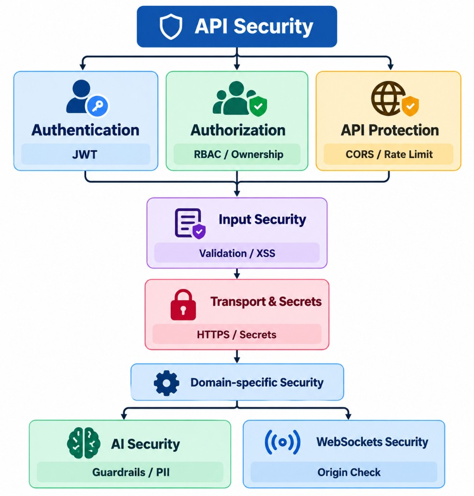

Security is an essential part of building a production-ready API. A secure application must protect user accounts, validate incoming data, control access, and prevent abuse.

<div style={{ maxWidth: 700, margin: '0 auto' }}>



</div>

## 1. Authentication and Authorization

**Authentication answers: Who are you?**

For example, a user logs in with their email and password. The server validates the credentials and issues a JWT (JSON Web Token).

```text
POST /login
     ↓
Validate credentials
     ↓
Generate JWT
     ↓
Return token
```

The client then sends the token with subsequent requests. FastAPI can verify the token and identify the current user.

**Authorization answers: What are you allowed to do?**

After identifying a user, the application must determine whether they have permission to perform a specific action.

For example:

```text
Admin
 ├── Create product
 ├── Update product
 └── Delete product

Customer
 ├── View product
 └── Create order
```

FastAPI dependencies can help implement these checks by retrieving the current user and verifying their permissions.

## 2. Cross-Origin Resource Sharing (CORS)

CORS controls which browser origins are allowed to make cross-origin requests to an API.

For example, if your frontend runs at `https://myapp.com`, you can configure FastAPI to allow requests from that origin:

```python
from fastapi import FastAPI
from fastapi.middleware.cors import CORSMiddleware

app = FastAPI()

app.add_middleware(
    CORSMiddleware,
    allow_origins=["https://myapp.com"],
    allow_credentials=True,
    allow_methods=["GET", "POST", "PUT", "DELETE"],
    allow_headers=["Authorization", "Content-Type"],
)
```

Avoid blindly using:

```python
allow_origins=["*"]
```

## 3. Rate Limiting

Rate limiting restricts how frequently a client can call an endpoint within a given period.

For example:

```text
100 requests per minute
         ↓
Limit exceeded
         ↓
429 Too Many Requests
```

A library such as SlowAPI can provide route-level rate limits:

```python
from fastapi import Request

@app.get("/products")
@limiter.limit("100/minute")
async def get_products(request: Request):
    return {"products": []}
```

Rate limiting helps reduce:

- Spam and automated abuse
- Brute-force login attempts
- Excessive resource consumption

## 4. Security Headers

Security headers instruct browsers how to handle application responses. They provide an additional layer of protection against certain browser-based attacks.

For example, middleware can add common security headers to responses:

```python
from fastapi import Request

@app.middleware("http")
async def security_headers(request: Request, call_next):
    response = await call_next(request)

    response.headers["X-Content-Type-Options"] = "nosniff"
    response.headers["X-Frame-Options"] = "DENY"
    response.headers["Referrer-Policy"] = (
        "strict-origin-when-cross-origin"
    )

    return response
```

These headers serve different purposes:

- `X-Content-Type-Options: nosniff` prevents browsers from guessing content types.
- `X-Frame-Options: DENY` prevents the page from being embedded in a frame.
- `Referrer-Policy` controls how much referrer information browsers send.

## 5. Input Validation and XSS Protection

Input validation ensures that incoming data matches the application's expected structure and constraints.

FastAPI integrates with Pydantic to validate request bodies automatically. For example:

```python
from pydantic import BaseModel, Field

class UserCreate(BaseModel):
    name: str = Field(min_length=1, max_length=100)
    age: int = Field(ge=0, le=120)
```

If a client submits invalid data:

```json
{
  "name": "John",
  "age": "hello"
}
```

FastAPI returns a validation error instead of passing the invalid value to the endpoint's business logic.

**Cross-Site Scripting (XSS)** occurs when malicious scripts are executed in a browser through untrusted content. For example, an attacker might submit:

```html
<script>alert("XSS")</script>
```

If your application intentionally accepts HTML, sanitize it with a library such as `nh3`:

```python
import nh3

clean_content = nh3.clean(user_content)
```

Sanitization should be configured according to the HTML features your application needs. For ordinary text, avoid rendering user input as HTML in the first place.

## 6. HTTPS and Sensitive Data

HTTPS encrypts data while it travels between the client and server, helping protect passwords, tokens, personal information, and other sensitive data from interception.

Production APIs should use HTTPS. When TLS terminates at a reverse proxy, configure the deployment to handle forwarded headers securely and only trust known proxies.

Applications must also avoid exposing sensitive information in API responses or logs.

Never return values such as:

- Passwords or password hashes
- JWT signing secrets
- API keys
- Database credentials

Passwords should be stored using a dedicated password-hashing algorithm, such as Argon2id, rather than as plaintext or with reversible encryption.

For JWTs, use an established library, explicitly restrict accepted signing algorithms, and validate relevant claims such as expiration and issuer when applicable.

## 7. Environment Variables and Secrets Management

Never hard-code secrets in application source code.

Avoid:

```python
JWT_SECRET = "my-super-secret-key"
```

Instead, load the value from the environment:

```python
import os

JWT_SECRET = os.environ["JWT_SECRET"]
DATABASE_URL = os.environ["DATABASE_URL"]
```

For local development, environment variables can be loaded from a `.env` file that is excluded from Git. In production, use your deployment platform's secret-management mechanism.