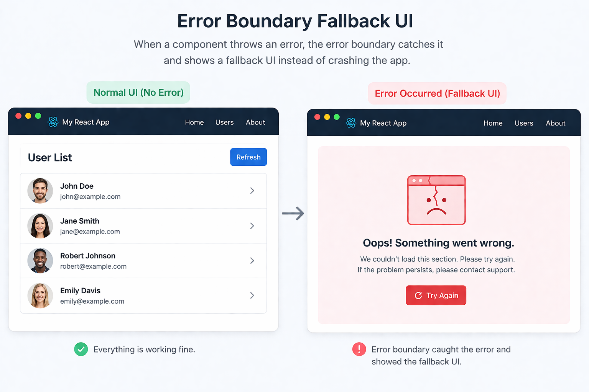

In React, if a component throws during render and nothing catches it, React can unmount the affected UI and users may see a blank screen. **Error Boundaries** prevent that by catching render-time errors and showing a fallback UI instead.



### 1. What Is an Error Boundary?

An Error Boundary is a component that catches errors thrown during rendering in its child component tree and displays a fallback UI instead of the failed content.

Without an Error Boundary, an uncaught rendering error can cause React to remove the affected UI from the screen.

In real apps, prefer the `react-error-boundary` library:

```bash
npm install react-error-boundary
```

```tsx
import { ErrorBoundary } from "react-error-boundary";

function Fallback({
  error,
  resetErrorBoundary,
}: {
  error: Error;
  resetErrorBoundary: () => void;
}) {
  return (
    <div role="alert">
      <p>Something went wrong: {error.message}</p>
      <button onClick={resetErrorBoundary}>
        Try again
      </button>
    </div>
  );
}

function App() {
  return (
    <ErrorBoundary FallbackComponent={Fallback}>
      <UserList />
    </ErrorBoundary>
  );
}
```

If `UserList` throws an error during rendering, the boundary displays the fallback UI.

**Why use Error Boundaries?**
- Prevent rendering errors from crashing the entire application UI.
- Provide a better user experience with fallback screens.
- Allow users to retry failed UI sections.
- Isolate failures in complex component trees.

### 2. What Errors Can Error Boundaries Catch?

Error Boundaries catch errors thrown during rendering, including errors from constructors and lifecycle methods in class components. They also catch errors thrown by descendant components during React-managed rendering.

However, they do not automatically catch errors from:

- Event handlers.
- Asynchronous callbacks, such as `setTimeout` or Promise rejections.
- Effects, including errors thrown inside `useEffect`.
- The Error Boundary itself.

React also has special handling for errors thrown inside transitions and errors from server-side rendering, so these cases should not be treated as ordinary client-side Error Boundary behavior.

### 3. Handling Asynchronous Errors

Use `showBoundary()` from `react-error-boundary` to forward an asynchronous error to the nearest Error Boundary.

```tsx
import { useEffect } from "react";
import {
  ErrorBoundary,
  useErrorBoundary,
} from "react-error-boundary";

function Users() {
  const { showBoundary } = useErrorBoundary();

  useEffect(() => {
    async function loadUsers() {
      try {
        const response = await fetch("/api/users");

        if (!response.ok) {
          throw new Error("Failed to load users");
        }

        await response.json();
      } catch (error) {
        showBoundary(error);
      }
    }

    loadUsers();
  }, [showBoundary]);

  return <div>User List</div>;
}

function Fallback({ error }: { error: Error }) {
  return <div role="alert">{error.message}</div>;
}

export default function App() {
  return (
    <ErrorBoundary FallbackComponent={Fallback}>
      <Users />
    </ErrorBoundary>
  );
}
```

Here, `showBoundary(error)` forwards the caught error to React's Error Boundary mechanism so the fallback UI can render.

**Important:** Error Boundaries are not a replacement for normal loading and error states. For expected API failures, displaying an inline error message and retry button is often more appropriate than treating every failure as an application error.

### 4. Resetting an Error Boundary

The `resetErrorBoundary()` function resets the boundary after an error so the failed content can render again.

You can also use `resetKeys` to reset the boundary when relevant values change.

```tsx
<ErrorBoundary
  FallbackComponent={Fallback}
  resetKeys={[userId]}
>
  <UserProfile userId={userId} />
</ErrorBoundary>
```

When `userId` changes, the boundary resets and attempts to render the updated content again.

Resetting the boundary does not automatically fix the underlying error. If the same problem remains, the fallback may appear again.